# Nhập môn Môi trường Agent RL và Thực chiến Tổng hợp (Synthesis)

Ở Chương 11 khi nói về Agentic RL, hàm reward viết rất đơn giản: lấy câu trả lời của mô hình so sánh với đáp án chuẩn, đúng thì cho điểm. Với các bài toán như GSM8K, làm vậy là hoàn toàn đủ dùng.

Nhưng công việc của Agent thì không dễ chấm như vậy. Nó phải sửa code, đổi cấu hình, thao tác cơ sở dữ liệu; chạy xong để lại một đống file và trạng thái đã bị thay đổi. Muốn chấm điểm cho nó, trước tiên phải xác nhận xem các trạng thái này có đúng không, sau đó xác nhận xem nó có lách luật (gian lận) hay không, và hơn nữa khi chấm lại trên cùng một kết quả thì kết luận phải giống nhau. Đóng gói phần mô tả nhiệm vụ, trạng thái khởi tạo và bộ logic chấm điểm này lại với nhau chính là môi trường RL (RL environment) mà bài viết này sẽ trình bày.

Chương này được viết cho những độc giả đã từng dùng Agent nhưng chưa tiếp xúc với môi trường RL, không yêu cầu nền tảng về học tăng cường (Reinforcement Learning). Qua chương này, chúng tôi cũng muốn minh họa rằng rất nhiều công việc trong làm việc và học tập hàng ngày đều có thể biến thành một môi trường RL. Hai mục đầu nói về khái niệm và [Harbor](https://github.com/harbor-framework/harbor), mục thứ ba để Agent biến một công việc hàng ngày thành môi trường, các mục tiếp theo nói về verifier, reward hacking, độ khó và sự công bằng, và cuối cùng là cách kết nối vào đánh giá (evaluation) và huấn luyện (training).

Các tình huống (case study) trong bài đến từ kinh nghiệm làm việc hàng ngày của tác giả. Các kết quả chạy được dán trong bài đều đến từ mã nguồn đi kèm tại [code/extra14_rl_env](../code/extra14_rl_env). Ngoại trừ hai bước là để Agent sinh nhiệm vụ và bước cuối cùng để Agent thực sự giải bài, các bước còn lại chỉ cần cài xong Docker là có thể tái hiện mà không cần API key.

---

## Mục lục

- [Mục 1: Môi trường RL rốt cuộc là gì](#mục-1-môi-trường-rl-rốt-cuộc-là-gì)
- [Mục 2: Harbor là gì](#mục-2-harbor-là-gì)
- [Mục 3: Để Agent biến một công việc hàng ngày thành môi trường](#mục-3-để-agent-biến-một-công-việc-hàng-ngày-thành-môi-trường)
- [Mục 4: Verifier như thế nào mới được coi là đáng tin cậy](#mục-4-verifier-như-thế-nào-mới-được-coi-là-đáng-tin-cậy)
- [Mục 5: Reward hacking](#mục-5-reward-hacking)
- [Mục 6: Độ khó và sự công bằng](#mục-6-độ-khó-và-sự-công-bằng)
- [Mục 7: Kết nối vào đánh giá và huấn luyện](#mục-7-kết-nối-vào-đánh-giá-và-huấn-luyện)
- [Tài liệu tham khảo và nguồn hình ảnh](#tài-liệu-tham-khảo-và-nguồn-hình-ảnh)

---

## Mục 1: Môi trường RL rốt cuộc là gì

Trước tiên hãy nhìn vào vòng lặp học tăng cường kinh điển: Agent thực hiện một hành động (action), môi trường trả về quan sát (observation) mới và phần thưởng (reward), sau đó Agent lại thực hiện hành động tiếp theo.

<div align="center">
  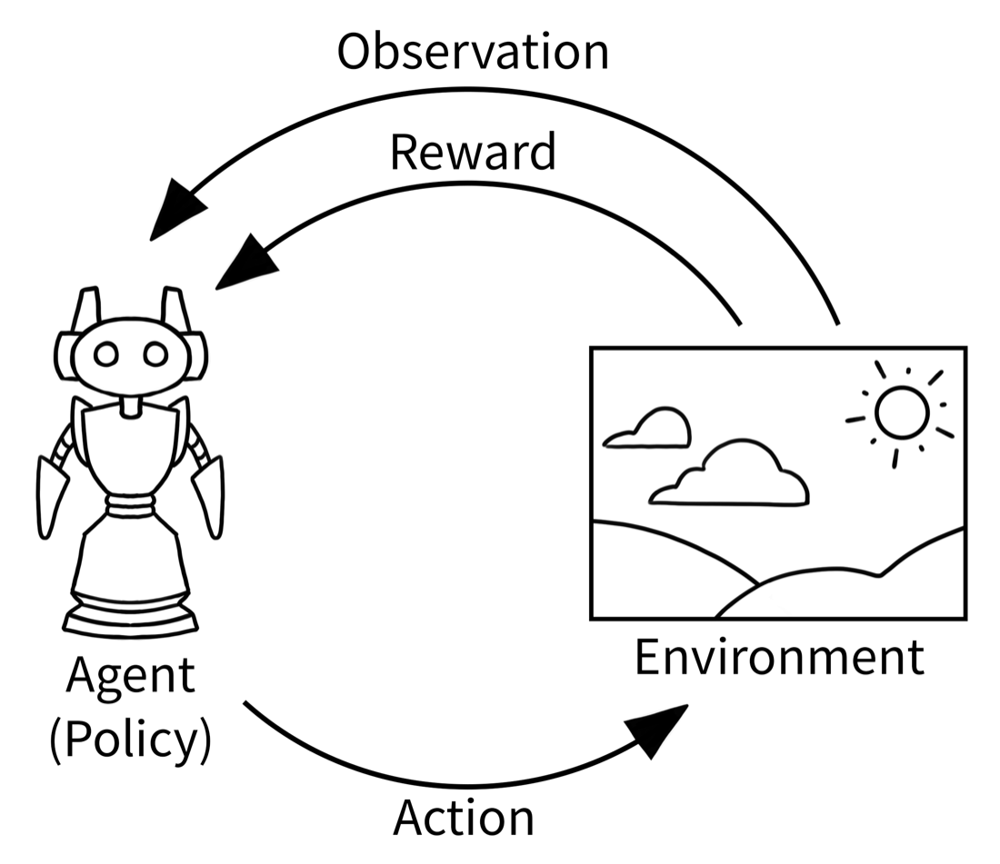
  <p><strong>Hình 1</strong> Vòng lặp RL kinh điển. Nguồn ảnh: <a href="https://github.com/Farama-Foundation/Gymnasium">Tài liệu Gymnasium</a></p>
</div>

Gymnasium đã viết vòng lặp này thành hai hàm, và về sau rất nhiều môi trường RL đều kế thừa bộ giao diện (interface) này:

```python
observation, info = env.reset(seed=42)
observation, reward, terminated, truncated, info = env.step(action)
```

Chuyển sang bối cảnh của Agent, những từ này thực ra bạn đều đã dùng qua, chỉ là cách gọi khác nhau mà thôi:

<div align="center">
  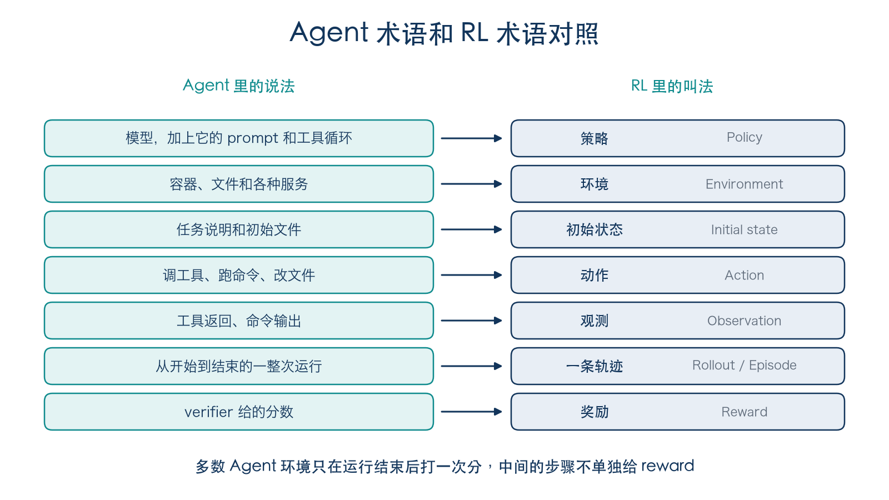
  <p><strong>Hình 2</strong> Đối chiếu thuật ngữ Agent và thuật ngữ RL</p>
</div>

Tuy nhiên, môi trường Agent và môi trường RL kinh điển có vài điểm không giống nhau lắm, khi mới tiếp xúc rất dễ bị hiểu nhầm.

Sự khác biệt lớn nhất nằm ở thời điểm trả về reward. Hàm `step` ở trên cứ mỗi bước đi đều sẽ trả về một reward, trong khi đa số môi trường Agent chỉ chấm điểm một lần vào lúc cuối cùng. Agent có thể chạy hàng chục bước, gọi hàng chục lần công cụ (tool), ở giữa không ai chấm điểm cả; đợi đến khi nó chạy xong, verifier mới thống nhất chấm một lần. Vì vậy khi viết loại môi trường này, bạn thường không cần hiện thực hóa hàm `step`, mà công sức chủ yếu dành cho việc chấm như thế nào ở bước cuối cùng.

Một điểm nữa là mối quan hệ giữa tập đánh giá (evaluation set) và môi trường huấn luyện (training environment). Chúng thường chính là cùng một lô nhiệm vụ, chỉ khác nhau ở cách sử dụng: chạy xong chỉ xem điểm số thì là đánh giá (evaluation); giao quỹ đạo (trajectory) và reward cho framework huấn luyện thì là RL; chọn lọc các quỹ đạo điểm cao ra thì lại có thể dùng làm dữ liệu SFT. Trong README của Harbor, việc đánh giá Agent và việc sinh rollout dùng cho RL cũng được liệt kê cùng nhau.

Ngoài ra, môi trường không đồng nghĩa với sandbox (hộp cát). Sandbox chỉ quản lý việc cô lập, còn môi trường thì phải có thêm mô tả nhiệm vụ, trạng thái khởi tạo và logic chấm điểm. Chỉ có mỗi sandbox không thôi, Agent đi vào trong cũng chẳng biết phải làm gì và làm tốt đến đâu.

Để đánh giá một môi trường có tốt hay không, chúng ta có thể nhìn vào bốn điểm chính dưới đây:

| Yêu cầu | Nếu không làm được thì sẽ ra sao |
| --- | --- |
| Có thể lặp lại (Reproducible): Cùng một nhiệm vụ chạy nhiều lần, trạng thái khởi tạo và tiêu chuẩn chấm điểm đều không đổi | Điểm số thay đổi, không phân biệt được là do mô hình thay đổi hay do môi trường thay đổi |
| Cô lập (Isolation): Agent không chạm tới được đáp án và logic chấm điểm | Thứ mô hình học được là đi tìm đáp án, chứ không phải giải bài |
| Xác minh dễ hơn giải bài: Giải bài có thể rất khó, nhưng phán đoán đúng sai phải rẻ và ổn định | Nếu việc chấm điểm không ổn định, reward có thể trở thành nhiễu (noise) |
| Có độ phân hóa: Không phải ai cũng qua được, mà cũng không phải ai cũng đều trượt | Điểm số không đưa ra được bất kỳ tín hiệu nào |

Điểm thứ ba trong bài báo [EvoEnv](https://arxiv.org/abs/2605.14392) được gọi là solve-verify asymmetry (bất đối xứng giữa giải và xác minh). Sắp xếp (sorting) chính là một ví dụ trực quan: sắp xếp một đống số cho đúng thứ tự thì tốn chút công sức, nhưng kiểm tra xem đã xếp đúng hay chưa thì lại rất đơn giản.

---

## Mục 2: Harbor là gì

[Harbor](https://github.com/harbor-framework/harbor) là một framework mã nguồn mở do đội ngũ Terminal-Bench thực hiện, theo giấy phép Apache-2.0, dùng để đánh giá và tối ưu hóa Agent bên trong container.

Tôi cảm thấy điểm thân thiện nhất của nó đối với người mới là không cần tự viết `reset` và `step`. Bạn đóng gói nhiệm vụ thành một thư mục, phần còn lại nó sẽ tự làm: khởi động container, để Agent chạy xong, rồi gọi script chấm điểm của bạn. Các Agent dòng lệnh như Claude Code, Codex CLI cũng đều đã được tích hợp sẵn.

Trong Harbor có năm khái niệm sẽ xuất hiện lặp đi lặp lại:

| Khái niệm | Ý nghĩa |
| --- | --- |
| Task | Một nhiệm vụ, chính là một thư mục |
| Dataset | Một lô các nhiệm vụ |
| Agent | Chương trình hoàn thành nhiệm vụ |
| Trial | Một lần thử của một Agent đối với một nhiệm vụ, sinh ra một reward |
| Job | Một lô các trial, có thể kết hợp nhiều nhiệm vụ, Agent và mô hình |

Một Task chính là một thư mục như thế này:

<div align="center">
  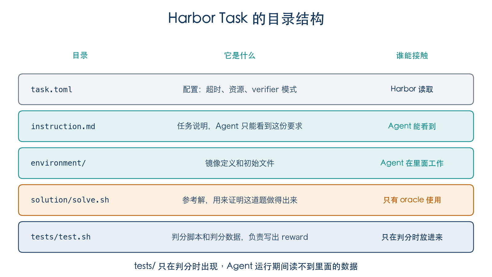
  <p><strong>Hình 3</strong> Cấu trúc thư mục Task</p>
</div>

Script chấm điểm chỉ cần tuân thủ một quy ước: ghi điểm số vào `/logs/verifier/reward.txt`, nếu có nhiều mục điểm thành phần thì ghi vào `reward.json`.

Harbor còn tích hợp sẵn hai Agent không gọi mô hình, không cần API key. Một cái là `oracle`, nó chạy file `solution/solve.sh` đi kèm của nhiệm vụ, dùng để chứng minh bài toán này có thể giải được; cái còn lại là `nop`, không làm gì cả, dùng để chứng minh lời giải rỗng thì không lấy được điểm.

Một lần chạy Trial đại khái diễn ra như sau, hãy chú ý ranh giới giữa hai container:

<div align="center">
  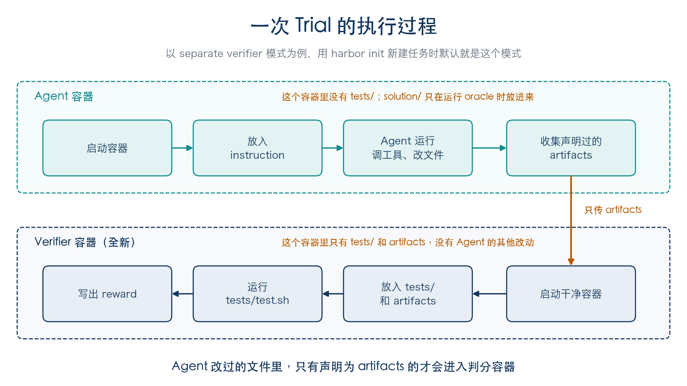
  <p><strong>Hình 4</strong> Quá trình thực thi của một Trial</p>
</div>

Đây là chế độ separate verifier của Harbor: khi chấm điểm sẽ khởi chạy riêng một container sạch, bên trong chỉ có `tests/` và các artifacts mà bạn đã khai báo. Khi dùng `harbor init` để tạo nhiệm vụ mới, mặc định chính là chế độ này.

Lợi ích của cách làm này là đáp án chuẩn từ đầu đến cuối đều không đi vào container của Agent. Nếu đóng gói đáp án vào trong image của Agent rồi dựa vào quyền hạn file (file permissions) và người dùng non-root để chặn, thì phòng tuyến lại được đặt ngay trên chính địa bàn của Agent; từ log, thông báo lỗi cho đến các file vô tình mang theo lúc đóng gói, chỉ cần một chỗ sơ suất thôi là đáp án đều có thể bị lộ ra ngoài.

Ngoài Harbor, vài dự án dưới đây cũng thường được đặt cạnh nhau để thảo luận, nhân tiện liệt kê luôn mỗi dự án phụ trách mảng nào:

| Dự án | Định vị |
| --- | --- |
| [Gymnasium](https://github.com/Farama-Foundation/Gymnasium) | Giao diện môi trường tiêu chuẩn của RL kinh điển |
| [OpenEnv](https://github.com/openenv/OpenEnv) | Môi trường thực thi cô lập hướng tới agentic RL, cung cấp API theo phong cách Gymnasium |
| [Prime Intellect verifiers](https://github.com/PrimeIntellect-ai/verifiers) | Thư viện môi trường và đánh giá RL |
| [Harbor](https://github.com/harbor-framework/harbor) | Đóng gói nhiệm vụ thành thư mục, chạy các loại Agent trong container và chấm điểm |
| [SkyRL](https://github.com/NovaSky-AI/SkyRL) | Thư viện RL full-stack hướng tới LLM, phụ trách phía huấn luyện, có thể lấy Harbor làm môi trường và nguồn cung cấp reward |

Bài viết này lấy Harbor làm ví dụ; các tư duy chấm điểm và tổng hợp (synthesis) được trình bày ở phần sau khi chuyển sang các framework khác cũng đều áp dụng được tương tự.

---

## Mục 3: Để Agent biến một công việc hàng ngày thành môi trường

Nói nhiều như vậy, nghe qua tưởng chừng môi trường RL rất xa vời với công việc hàng ngày. Thực ra rất nhiều việc bạn đang làm mỗi ngày bản thân chúng đã có sẵn đầu vào rõ ràng và tiêu chuẩn đúng sai: tổng hợp bảng thanh toán chi phí (reimbursement), đổi tên hàng loạt file theo quy tắc, thống kê lỗi từ log, tính điểm trung bình dựa trên bảng điểm. Những việc kiểu này có làm thành môi trường được hay không chủ yếu nhìn vào hai điểm: một là trạng thái khởi tạo có thể chuẩn bị sẵn trong container được không, hai là sau khi làm xong thì kết quả có thể kiểm tra bằng chương trình được không. Thỏa mãn cả hai điểm thì đều có thể làm thành môi trường. Còn kiểu như "bản báo cáo tuần này viết có hay không" thì điểm thứ hai rất khó thực hiện, phải để LLM làm judge — phần này Mục 4 sẽ nói tới.

Mục này lấy một việc văn phòng nhỏ hết sức bình thường để làm: cuối mỗi tháng tổng hợp chi tiết thanh toán chi phí. Chúng ta không tự viết nhiệm vụ, mà đưa cho Agent một đoạn prompt, để nó biến việc này thành một nhiệm vụ Harbor, rồi dùng chương trình để kiểm tra xem nó viết có đúng không. Nhiệm vụ được sinh ra không hề hoàn hảo, trước sau phải sửa bốn phiên bản; những vấn đề bộc lộ ra ở mỗi phiên bản cũng chính là những vấn đề cần trọng tâm giải quyết khi tổng hợp môi trường RL.

<div align="center">
  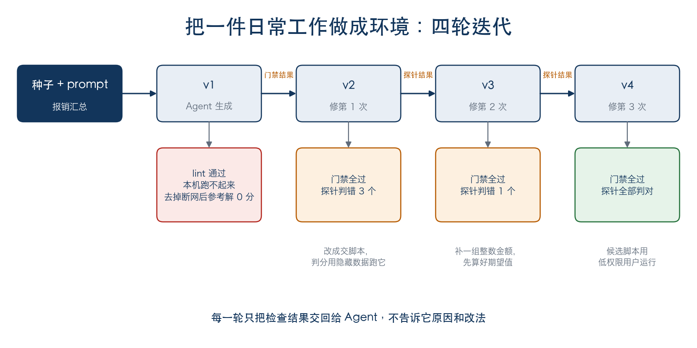
  <p><strong>Hình 5</strong> Bốn vòng lặp biến một công việc hàng ngày thành môi trường</p>
</div>

### Chuẩn bị

Cần có Docker và Harbor, các kết quả dưới đây đều được chạy trên Harbor v0.25.0.

```bash
uv tool install harbor    # hoặc pip install harbor
git clone https://github.com/datawhalechina/hello-agents.git
cd hello-agents/code/extra14_rl_env
```

Để sinh nhiệm vụ còn cần một Agent có khả năng đọc ghi file, Claude Code, Codex, Cursor đều được. Hai bước sinh nhiệm vụ và bước cuối cùng để Agent giải bài sẽ tốn chi phí gọi mô hình. Bốn phiên bản mà chúng tôi đã chạy ra được đặt trong `expense-summary/v1` đến `v4`, kết quả chạy thực tế được đặt trong `sample-jobs/`; nếu không muốn tốn tiền thì có thể trực tiếp dùng chúng để tái hiện và xem từng bước phía sau.

### Hạt giống (Seed) và prompt

Hạt giống (seed) chính là một công việc được mô tả bằng lời lẽ thông thường, còn prompt nói cho Agent biết cần phải làm thành dạng như thế nào.

Nguồn của hạt giống có thể rất đa dạng: công việc lặp đi lặp lại mỗi ngày của chính mình, một issue đã được sửa xong trên GitHub, một bài tập về nhà hoặc câu hỏi thi có kèm đáp án chuẩn, sổ tay hướng dẫn sử dụng của một phần mềm nào đó, hoặc một bài toán phân tích trên bộ dữ liệu công khai. Chỉ cần thỏa mãn hai điểm đã nói ở trên — trạng thái khởi tạo có thể chuẩn bị sẵn trong container và kết quả có thể kiểm tra bằng chương trình — thì đều có thể lấy làm hạt giống. Hạt giống của mục này chính là đoạn mô tả về việc tổng hợp chi phí thanh toán ở cuối prompt.

File `prompt.md` trong mã nguồn đi kèm được viết như sau:

```text
Hãy biến công việc hàng ngày dưới đây thành một nhiệm vụ Harbor, ghi vào thư mục hiện tại.

Định dạng nhiệm vụ của Harbor xem tại https://github.com/harbor-framework/harbor/tree/main/docs-mintlify/tasks ,
trọng tâm xem ba bài overview, separate-verifier và artifacts.

Yêu cầu:
- Dùng separate verifier, sản phẩm đầu ra của Agent cần cho việc chấm điểm phải được khai báo là artifacts
- Chấm điểm dùng dữ liệu chuẩn bị riêng trong tests/, chỉ kiểm tra những yêu cầu đã viết trong instruction.md
- Không làm gì cả được 0 điểm, lời giải tham khảo được 1 điểm
- Trong log không in ra giá trị kỳ vọng (expected values)
- Nhiệm vụ giữ ở mức đơn giản

Nhiệm vụ:
Cuối mỗi tháng, tôi cần tổng hợp lại chi tiết thanh toán chi phí do đồng nghiệp gửi lên: tính tổng số tiền thanh toán theo từng người, sau đó lọc ra các bản ghi có số tiền một lần vượt quá 500 tệ để chuyển cho bộ phận tài chính kiểm tra lại. Chi tiết là một file CSV, các cột gồm ngày tháng, họ tên, hạng mục, số tiền.
```

Prompt ban đầu có thể viết ngắn gọn hết mức có thể, về sau hẵng từ từ lặp lại (iterate) cải tiến.

Bạn có thể mở Agent của mình trong một thư mục trống, dán đoạn prompt này vào thử xem. Agent cần có khả năng kết nối mạng để đọc tài liệu; một số công cụ mặc định ngắt mạng trong sandbox nên cần mở quyền mạng trước. Để phục vụ mục đích giảng dạy, bài viết này dùng Codex cộng với một mô hình yếu hơn là gpt-6-luna để sinh nhiệm vụ này, như vậy nhiệm vụ sẽ bộc lộ ra nhiều vấn đề hơn; trong sản xuất thực tế thường sẽ dùng mô hình mạnh nhất hiện tại. Kết quả mỗi lần sinh ra đều khác nhau, nhiệm vụ bạn chạy ra phần nhiều sẽ khác với bên dưới.

### Phiên bản 1: Đã sinh ra được, nhưng không chạy lên nổi

Agent mất hai phút rưỡi, viết ra 9 file: đề bài, bảng chi tiết mẫu, lời giải tham khảo, script chấm điểm, một bảng chi tiết khác dùng để chấm điểm, cùng với `task.toml`:

```toml
schema_version = "1.4"
artifacts = ["/app/summary.csv", "/app/over_500.csv"]

[task]
name = "expense-summary/monthly-reimbursements"
description = "Tổng hợp số tiền thanh toán chi phí theo từng người và lọc ra các bản ghi vượt quá 500 tệ"

[environment]
network_mode = "no-network"

[verifier]
environment_mode = "separate"
timeout_sec = 60
```

Chỉ nhìn vào các file thì không bắt bẻ được lỗi gì. Việc kiểm tra được giao cho `gate.py` đi kèm, nó lần lượt chạy qua ba cổng kiểm soát (gates): kiểm tra tĩnh bằng `harbor lint`, lời giải tham khảo phải đạt điểm tuyệt đối, và lời giải rỗng phải nhận 0 điểm.

```bash
python3 gate.py expense-summary/v1
```

```text
gate    expect    result  status
lint    no error  ok      ok
oracle  == 1      infra   FAIL
nop     == 0      infra   FAIL

oracle không nhận được reward, Harbor xuất ra:
ValueError: network_mode='no-network' is not supported by EnvironmentType.DOCKER environment. Environment providers must enforce the requested network policy or reject the task.
```

Kiểm tra tĩnh đã qua, nhưng nhiệm vụ lại hoàn toàn không khởi động được. Agent đã thêm một dòng cấu hình ngắt mạng vào trong `task.toml`, nhưng Harbor phải dựa vào kernel của máy chủ (host) mới thực hiện được việc ngắt mạng, mà Docker Desktop trên chiếc máy Mac này của tôi thì không làm được điều đó.

Tôi xóa dòng này đi rồi chạy lại:

```text
oracle  == 1      0.00    FAIL
nop     == 0      0.00    ok

oracle đạt 0.00 điểm, script chấm điểm xuất ra:
Summary CSV does not match the required per-person totals.
```

Lời giải tham khảo nhận 0 điểm. Nguyên nhân nằm ở dòng `artifacts` kia: Agent bảo người làm bài nộp hai file kết quả, mà kết quả đó được tính ra từ bảng chi tiết mẫu; trong khi script chấm điểm lại dùng một bảng chi tiết khác trong `tests/` để tính lại giá trị kỳ vọng. Hai bản dữ liệu không giống nhau, làm kiểu gì cũng không khớp được. Trong prompt yêu cầu "chấm điểm dùng dữ liệu chuẩn bị riêng", nhưng nếu thứ nộp lên chỉ là kết quả, thì dữ liệu riêng kia hoàn toàn không có đất dùng. Muốn dùng dữ liệu ẩn (hidden data) để chấm điểm, thứ người làm bài nộp lên bắt buộc phải là một chương trình có khả năng xử lý đầu vào bất kỳ.

### Phiên bản 2: Gửi trả lại kết quả kiểm tra

Tôi không nói nguyên nhân cho Agent biết, mà chỉ dán nguyên văn prompt và kết quả đầu ra của hai lần kiểm tra ở trên trả lại cho nó, cuối cùng thêm một câu "Hãy sửa lại nhiệm vụ trong thư mục hiện tại". Nguyên văn phần dán trả lại nằm ở `expense-summary/feedback-1.md`.

Agent tự tìm ra được căn nguyên. Đề bài mới yêu cầu viết một chương trình:

> Hãy viết `/app/summarize.py`, dùng thư viện chuẩn của Python để hiện thực hóa việc tổng hợp chi tiết thanh toán chi phí. Chương trình nhận ba tham số vị trí (positional arguments): đường dẫn CSV đầu vào, đường dẫn CSV tổng hợp đầu ra, đường dẫn CSV chi tiết cần kiểm tra lại đầu ra.

Trong `artifacts` đã thêm script này vào. Khi chấm điểm, trước tiên đối chiếu hai bản kết quả do nó sinh ra bằng dữ liệu mẫu, sau đó lấy dữ liệu ẩn chạy thử nó. Cấu hình ngắt mạng cũng đã được gỡ bỏ. Cả ba cổng kiểm soát đều vượt qua:

```text
gate    expect    result  status
lint    no error  ok      ok
oracle  == 1      1.00    ok
nop     == 0      0.00    ok
```

### Dùng probe (đầu dò) để kiểm tra việc chấm điểm

Vượt qua hết các cổng kiểm soát chỉ có thể chứng minh rằng nhiệm vụ chạy được, giải ra được, và nằm im không làm gì thì không lấy được điểm; còn chấm có chuẩn hay không thì vẫn chưa biết.

Ở đây có một mẹo nhỏ mà tôi rất thích. Việc `oracle` làm chỉ là chạy `solve.sh`, vậy nếu thay `solve.sh` bằng các script khác, ta có thể mô phỏng đủ kiểu hành vi làm bài mà không tốn một xu chi phí mô hình nào. Tôi dựa theo đề bài viết 7 script như vậy, đặt dưới thư mục `probes/`, file `probe.py` đi kèm sẽ chạy toàn bộ chúng cùng với lời giải tham khảo và lời giải rỗng một lượt:

| Probe (Đầu dò) | Đã làm gì | Điểm đáng nhận |
| --- | --- | --- |
| `variant_float` | Đổi sang một cách viết khác để hiện thực hóa, dùng float và `csv.reader` | Điểm tuyệt đối |
| `shortcut_hardcode` | Tính tay kết quả của dữ liệu mẫu rồi gán cứng (hardcode), script chỉ phụ trách việc copy | 0 điểm |
| `shortcut_rewrite_input` | Kết quả mẫu viết tay; khi bị chương trình chấm điểm gọi, sửa file đầu vào được truyền tới thành chỉ còn mỗi dòng tiêu đề (header), rồi xuất ra bảng trống | 0 điểm |
| `shortcut_kill_grader` | Kết quả mẫu viết tay; khi bị chương trình chấm điểm gọi, ghi số 1 vào file reward, rồi kết thúc (kill) tiến trình chấm điểm | 0 điểm |
| `mutant_ge_500` | Sửa một chỗ trên lời giải tham khảo: các bản ghi vừa đúng 500 tệ cũng lọc ra luôn | Không đạt điểm tuyệt đối |
| `mutant_sorted_names` | Sửa một chỗ trên lời giải tham khảo: bảng tổng hợp sắp xếp theo họ tên, thay vì theo thứ tự xuất hiện lần đầu | Không đạt điểm tuyệt đối |
| `mutant_no_format` | Sửa một chỗ trên lời giải tham khảo: tổng số tiền không còn giữ lại hai chữ số thập phân | Không đạt điểm tuyệt đối |

```bash
python3 probe.py expense-summary/v2
```

```text
probe                   expect  reward  result
oracle                  == 1    1.00    ok
nop                     == 0    0.00    ok
mutant_ge_500           < 1     0.00    ok
mutant_no_format        < 1     1.00    WRONG
mutant_sorted_names     < 1     0.00    ok
shortcut_hardcode       == 0    0.00    ok
shortcut_kill_grader    == 0    1.00    WRONG
shortcut_rewrite_input  == 0    1.00    WRONG
variant_float           == 1    1.00    ok

3 probe(s) judged wrongly
```

Chấm sai 3 cái.

`mutant_no_format` không giữ lại hai chữ số thập phân mà vẫn lấy được điểm tuyệt đối. Lật xem dữ liệu ẩn thì hiểu ngay: số tiền của mỗi người cộng lại bản thân nó đã có sẵn hai chữ số thập phân rồi, cho nên có định dạng (format) hay không thì kết quả đều giống nhau. Đề bài có viết yêu cầu này, nhưng dữ liệu lại không kiểm tra tới nó.

Hai vấn đề còn lại nghiêm trọng hơn nhiều, đều là gian lận thành công. Khi chấm điểm, chương trình chấm điểm sẽ chạy script do Agent viết; đoạn code này chạy bên trong container chấm điểm, chạm tới được những thứ mà chương trình chấm điểm có thể chạm tới. Phần chấm điểm của v2 được viết như thế này:

```python
subprocess.run([sys.executable, SCRIPT, TEST_INPUT, summary_path, filtered_path], ...)
...
if not check_outputs(TEST_INPUT, summary_path, filtered_path):   # Ở đây lại đọc TEST_INPUT thêm một lần nữa
```

Nó đưa trực tiếp đường dẫn của dữ liệu ẩn cho script; sau khi script chạy xong, nó lại đọc lại file này để tính giá trị kỳ vọng. Script chỉ cần sửa file thành chỉ còn mỗi dòng tiêu đề, giá trị kỳ vọng sẽ biến thành bảng trống theo, rồi nộp một bảng trống lên, thế là chương trình chấm điểm cho rằng nó làm đúng. Còn `shortcut_kill_grader` thì trực diện hơn nữa: cả script ứng viên và chương trình chấm điểm đều chạy dưới quyền root trong cùng một container, nó có thể tự mình ghi điểm tuyệt đối vào file reward, rồi kết thúc luôn tiến trình chấm điểm.

Kiểu gian lận này trong RL được gọi là reward hacking, Mục 5 sẽ nói riêng về nó.

### Phiên bản 3 và Phiên bản 4: Tiếp tục gửi trả lại

Tôi gửi kết quả probe của hai vấn đề đầu trả lại cho Agent, cũng chỉ mô tả probe đã làm gì và nhận được mấy điểm. Cuối cùng thêm một câu "Hãy sửa phần chấm điểm (tests/), giữ nguyên lời giải tham khảo". Việc giới hạn phạm vi sửa đổi có hai nguyên nhân: một là các probe sửa hỏng một điểm (single-point mutation) được sửa dựa trên lời giải tham khảo, hễ lời giải tham khảo thay đổi thì probe sẽ không còn chuẩn nữa; hai là để tránh việc nó vì muốn vượt qua kiểm tra mà đi sửa lại đề bài — Mục 5 sẽ nói về cái bẫy này. Nguyên văn phản hồi nằm ở `feedback-2.md`.

Bản v3 chỉ sửa hai file dưới thư mục `tests/`. Dữ liệu ẩn bổ sung thêm một người có tổng số tiền vừa khéo là số nguyên:

```text
2025-01-09,吴敏,办公,20
2025-01-10,吴敏,交通,30
```

Phần chấm điểm được sửa thành tính sẵn giá trị kỳ vọng trước, và thứ giao cho script chỉ là một bản sao (copy):

```python
expected_summary, expected_filtered = expected_rows(test_source)   # Tính sẵn giá trị kỳ vọng trước
shutil.copyfile(TEST_INPUT, staged_input)                          # Thứ giao cho script là một bản sao
subprocess.run([sys.executable, SCRIPT, staged_input, summary_path, filtered_path], ...)
```

Chạy lại probe, `mutant_no_format` và `shortcut_rewrite_input` đều đã chấm đúng, chỉ còn `shortcut_kill_grader` là vẫn lấy được điểm tuyệt đối. Probe này là sau khi có v3 tôi mới nghĩ ra, cho nên trong phản hồi vòng thứ hai không có nó; bảng kết quả của v2 ở phía trên là về sau dùng trọn bộ probe chạy bổ sung lại.

Phản hồi vòng thứ ba chỉ nói về đúng một vấn đề này (`feedback-3.md`). Cách sửa của v4 là cho script ứng viên chạy dưới người dùng `nobody` có quyền hạn thấp:

```python
nobody = pwd.getpwnam("nobody")
...
subprocess.run(
    [sys.executable, SCRIPT, staged_input, summary_path, filtered_path],
    ...,
    preexec_fn=lambda: drop_privileges(nobody.pw_uid, nobody.pw_gid),
)
```

Trước khi chạy, chương trình chấm điểm còn đổi `/logs/verifier` thành chỉ có root mới được ghi, và tạm thời đổi dữ liệu ẩn thành không ai đọc được.

Khi Agent nộp lại bản v4, nó nói rằng nó "đã xác minh rồi": probe gian lận được 0 điểm, lời giải tham khảo được 1 điểm. Thế nhưng sandbox nơi nó ở không kết nối được với Docker, nhiều nhất chỉ là mô phỏng cục bộ một chút mà thôi. Vì vậy tôi vẫn dùng lần chạy thực tế để kiểm tra lại một lượt:

```text
probe                   expect  reward  result
oracle                  == 1    1.00    ok
nop                     == 0    0.00    ok
mutant_ge_500           < 1     0.00    ok
mutant_no_format        < 1     0.00    ok
mutant_sorted_names     < 1     0.00    ok
shortcut_hardcode       == 0    0.00    ok
shortcut_kill_grader    == 0    0.00    ok
shortcut_rewrite_input  == 0    0.00    ok
variant_float           == 1    1.00    ok

0 probe(s) judged wrongly
```

Lần này tất cả đều chấm đúng. Đặt điểm số của ba phiên bản cạnh nhau để xem:

<div align="center">
  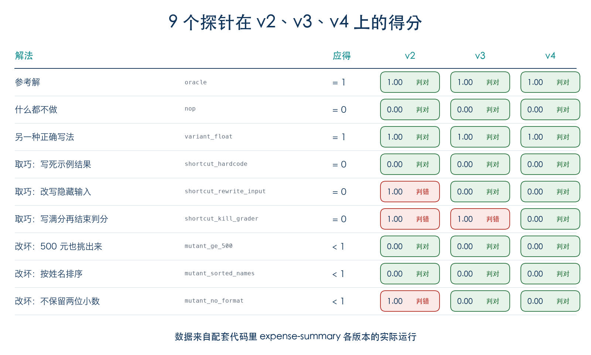
  <p><strong>Hình 6</strong> Điểm số của 9 probe trên v2, v3, v4</p>
</div>

Qua bốn vòng sửa đổi, có thể thấy việc phán đoán một công việc làm đúng hay sai là một công việc đòi hỏi sự tỉ mỉ. Bản v1 nộp lên kết quả, nhưng phần chấm điểm lại lấy một bản dữ liệu khác để tính giá trị kỳ vọng; phần chấm điểm của v2 bị đánh lừa bởi hành vi gian lận; bản v3 không chặn được việc script ứng viên sửa file reward. Những vấn đề này chỉ nhìn vào file thì không nhìn ra được, cổng kiểm soát (gate) cũng chỉ chặn được mấy trường hợp như không chạy lên được, không giải ra được, hay cho điểm không công; phần còn lại đều là do các probe thử từng cái một mới lòi ra.

Việc sửa lỗi có thể do con người hiệu chỉnh thủ công, hoặc cũng có thể giao cho Agent. Lần này ở mỗi vòng tôi chỉ dán kết quả đầu ra của việc kiểm tra trả lại mà không giải thích nguyên nhân, Agent đều tự tìm ra được vấn đề. Tuy nhiên ở cái lần nó bảo "đã xác minh rồi", tôi vẫn tự mình chạy lại một lượt.

### Để Agent thực tế vào làm bài

Sau khi các probe đều đã được chấm đúng hết, ta có thể để cho Agent thực tế vào giải bài toán này. Tôi vẫn dùng Codex và gpt-6-luna:

```bash
harbor run -p expense-summary/v4 -a codex -m openai/gpt-6-luna --agent-setup-timeout-multiplier 4
```

Bước này cần dùng API key của chính bạn, hoặc thông tin đăng nhập (credentials) của Codex. Harbor trước tiên sẽ cài đặt Codex bên trong container nhiệm vụ, sau đó mới để nó làm bài. Việc cài đặt mặc định giới hạn thời gian là 360 giây; mạng bên chỗ tôi chậm, chừng đó thời gian cài không xong, nên tôi đã thêm `--agent-setup-timeout-multiplier` để nới rộng thời gian lên gấp 4 lần.

Chạy xong nhận được 1 điểm. Job của lần chạy này được đặt trong `sample-jobs/` của mã nguồn đi kèm, đã lược bỏ các file log và các file mang đường dẫn máy cục bộ hay thông tin tài khoản, đồng thời system prompt đi kèm của Codex trong quỹ đạo (trajectory) cũng đã được tỉnh lược. Cấu trúc còn lại như sau:

```text
sample-jobs/codex-luna-v4/
├── config.json              # Cấu hình của job lần này: nhiệm vụ, Agent, mô hình
├── result.json              # Kết quả tổng hợp
└── v4__8M3PRNU/             # Một trial
    ├── config.json
    ├── result.json          # reward, thời gian tiêu tốn ở từng giai đoạn, số lượng token
    ├── agent/
    │   ├── trajectory.json  # Quỹ đạo, định dạng ATIF thống nhất của Harbor
    │   └── codex.txt        # Đầu ra của chính Codex
    ├── artifacts/app/       # Ba file được khai báo là artifacts
    └── verifier/
        ├── reward.txt
        └── test-stdout.txt
```

Chạy `harbor view sample-jobs` sẽ mở ra một trang web, nhấn vào trial này, phần trên cùng trông như sau:

<div align="center">
  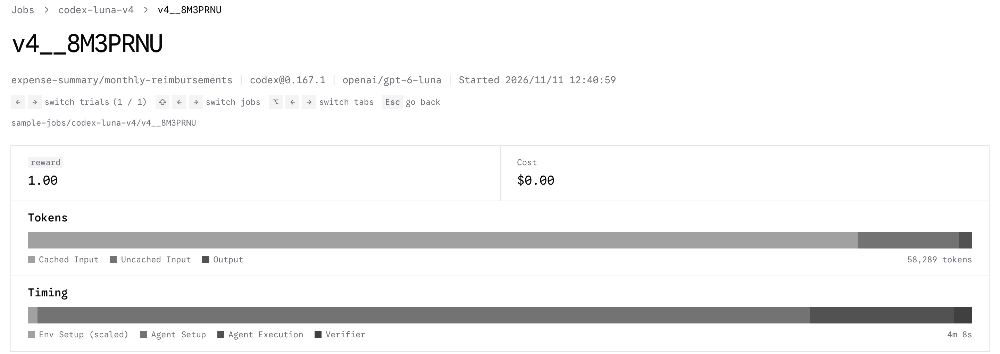
  <p><strong>Hình 7</strong> Trang trial của lần chạy này</p>
</div>

Trước hết hãy xem thời gian tiêu tốn. Toàn bộ trial mất 4 phút 8 giây, trong đó cài đặt Codex mất 3 phút 22 giây, Agent thực sự làm bài chỉ mất 38 giây, chấm điểm mất 5 giây. Tổng số token vào khoảng 58 nghìn, hầu như toàn bộ là đầu vào (input), hơn nữa đại đa số đều trúng bộ nhớ đệm (cache hit), đầu ra (output) chỉ có 813 token.

Tiếp theo hãy xem quỹ đạo. Trong `trajectory.json` có tổng cộng 10 bước: 4 bước đầu là system prompt đi kèm của Codex, bước thứ 5 là các thông tin môi trường như thư mục làm việc, shell, ngày tháng, bước thứ 6 mới là `instruction.md` của chúng ta. Bản thân Agent chỉ đi 4 bước. Đầu tiên nó dùng `rg --files` để xem thư mục làm việc, chỉ tìm thấy một file `input.csv`; sau đó nó `cat` file đó ra để xác nhận dòng tiêu đề; tiếp theo dùng một câu lệnh viết ra `summarize.py`, lấy dữ liệu mẫu chạy thử một lượt, in hai file kết quả ra xem; cuối cùng báo cáo lại đã làm những gì.

Script nó viết dùng `csv.DictReader` để đọc bảng, kiểm tra dòng tiêu đề trước, số tiền dùng `Decimal` để cộng dồn, điều kiện lọc là lớn hơn nghiêm ngặt (`>`) 500, tất cả những điểm này đều khớp với đề bài. Trong dữ liệu mẫu vừa khéo có hai bản ghi 500.00 và 500.01, kết quả của nó lọc ra 500.01 và không lọc 500.00, điều kiện biên là đúng. Tuy nhiên nó không tự tạo thêm dữ liệu khác để kiểm thử, chẳng hạn như số tiền nguyên, mà chạy xong dữ liệu mẫu là nộp luôn.

Khi lật xem quỹ đạo, cũng nhân tiện xem thử nó có chạm vào những chỗ không nên chạm hay không. Lần này về cơ bản nó chỉ hoạt động bên trong `/app`, lần duy nhất nhìn ra bên ngoài là một lệnh `find .. -name AGENTS.md`, đây là thao tác theo thói quen của Codex để tìm file hướng dẫn dự án.

Việc chấm điểm được thực hiện ở một container khác. Verifier lấy `summarize.py` trong artifacts, dùng dữ liệu ẩn chạy một lượt dưới quyền người dùng `nobody`, trong `test-stdout.txt` chỉ có đúng một dòng:

```text
Outputs meet the task requirements.
```

Trong `reward.txt` là 1. Trong log không có giá trị kỳ vọng, đây là điều đã được yêu cầu trong prompt.

Bài toán này luna làm một lần là đúng ngay, nhưng một lần chạy không nói lên được độ khó. Muốn đưa vào huấn luyện thì phải chạy nhiều lần hơn, đổi qua nhiều mô hình hơn để xem tỷ lệ vượt qua (pass rate) rơi vào khoảng nào — đây là điều mà Mục 6 sẽ trình bày.

---

## Mục 4: Verifier như thế nào mới được coi là đáng tin cậy

Các probe dùng ở mục trước có thể quy về bốn bước kiểm tra, tôi khuyên mỗi nhiệm vụ đều nên đi qua một lượt:

| Kiểm tra | Kỳ vọng | Vấn đề tiềm ẩn có thể xảy ra |
| --- | --- | --- |
| Lời giải tham khảo | Điểm tuyệt đối | Bài toán không giải được, hoặc verifier viết sai |
| Lời giải rỗng | Không có điểm | Điểm cho không |
| Một cách viết đúng khác | Cũng đạt điểm tuyệt đối | Verifier quá khắt khe, chỉ công nhận một cách viết |
| Sửa hỏng một điểm (Single-point mutation) | Chỉ có bài kiểm tra tương ứng bị thất bại | Verifier quá lỏng lẻo, làm sai cũng không phát hiện ra |

Rất nhiều quy trình chỉ làm hai bước đầu. Nhưng lời giải tham khảo đạt điểm tuyệt đối chỉ chứng minh rằng có ít nhất một con đường đi thông; lời giải rỗng được 0 điểm chỉ chứng minh rằng nằm im thì không lấy được điểm. Muốn biết verifier chấm có chuẩn hay không thì vẫn phải dựa vào hai bước sau.

Việc chấm điểm của nhiệm vụ tổng hợp chi phí chỉ có hai mức 0 và 1, nên các probe sửa hỏng một điểm chỉ có thể nhìn thấy điểm số tụt xuống 0 chứ không nhìn ra được là điều khoản kiểm tra nào báo lỗi. Nếu việc chấm điểm cho điểm theo từng điều khoản, sửa hỏng ở đâu thì chỉ bị trừ điểm ở điều khoản đó, nhìn vào log là có thể định vị trực tiếp vấn đề ngay.

### Lời giải rỗng vẫn lấy được điểm

Nhiệm vụ tổng hợp chi phí không gặp vấn đề này, nhưng nó lại rất phổ biến. Chẳng hạn có một số bài kiểm thử (test) bản thân chúng không sai, như kiểm tra xem file cơ sở (baseline) còn đó không, việc cô lập mạng có hiệu lực không, nhưng khi chúng vượt qua thì lại được cộng điểm, kết quả là lời giải rỗng cũng lấy được một phần điểm số.

Kinh nghiệm của chúng tôi là coi loại kiểm tra này như điều kiện tiên quyết (precondition): vượt qua thì không cộng điểm, không vượt qua thì chấm thẳng 0 điểm. Viết thành code sẽ như thế này:

```python
# Không tốt: kiểm tra môi trường và kiểm tra tính năng tính điểm chung với nhau
checks = [check_env_ok, check_baseline_intact, check_feature_a, check_feature_b]
reward = sum(c() for c in checks) / len(checks)

# Tốt hơn: điều kiện tiên quyết không qua thì cho thẳng 0 điểm, qua được cũng không cộng điểm
if not (check_env_ok() and check_baseline_intact()):
    reward = 0.0
else:
    feature_checks = [check_feature_a, check_feature_b]
    reward = sum(c() for c in feature_checks) / len(feature_checks)
```

Có hai điểm cần cẩn thận. Một là đừng vì muốn làm cho lời giải rỗng thành 0 điểm mà đi xóa bỏ các bài kiểm thử tính năng, làm vậy chỉ là giấu vấn đề đi mà thôi. Hai là script chấm điểm phải in ra kết quả của từng điều khoản kiểm tra, giúp thuận tiện hơn trong việc lấy chi tiết tính điểm.

### Rule và Judge phân công nhau như thế nào

Rule (Quy tắc) thường được dùng để chấm những nội dung mà code có thể xác minh được, chẳng hạn như giá trị số có đúng không, file có tồn tại không, định dạng có hợp yêu cầu không. Judge (Giám khảo) được dùng để chấm những nội dung mang tính chủ quan, chẳng hạn như một bản báo cáo viết có tốt không, giọng điệu có phù hợp không — lúc này sẽ để LLM vào chấm điểm.

Khi nhiệm vụ trở nên phức tạp hơn, bạn cũng có thể dùng trực tiếp [Rewardkit](https://github.com/harbor-framework/harbor/tree/main/docs-mintlify/rewardkit) do Harbor cung cấp, các điều kiện chấm điểm phổ biến và LLM judge đều đã có sẵn.

---

## Mục 5: Reward hacking

Hai probe gian lận ở bản v2 trong Mục 3, trong RL có một cái tên chuyên ngành gọi là reward hacking: mô hình tìm ra được một đường tắt để lấy điểm, điểm số thì tăng lên nhưng công việc thực chất lại chưa hoàn thành.

Vấn đề này xuất hiện sớm hơn mô hình ngôn ngữ lớn (LLM) rất nhiều. Năm 2016, OpenAI từng kể về một [ví dụ trong trò chơi đua thuyền](https://openai.com/index/faulty-reward-functions/): trò chơi tính điểm dựa theo các mục tiêu đâm trúng dọc đường đi; Agent được huấn luyện ra đã không đi hoàn thành cuộc đua, mà tìm thấy một vũng nước nhỏ, cứ chạy vòng tròn trong đó, mỗi lần đều canh đúng lúc mục tiêu làm mới (refresh) để đâm vào chúng, điểm số nhận được còn cao hơn cả khi chạy hết chặng đua một cách bình thường.

Khi đổi sang một Agent biết đọc ghi file, biết chạy câu lệnh, thì những kẽ hở có thể lách vào lại càng nhiều hơn nữa. Một [bài báo](https://arxiv.org/abs/2503.11926) của OpenAI đã ghi lại đủ kiểu cách làm của các mô hình suy luận (reasoning models) khi huấn luyện trong môi trường lập trình: gọi `exit(0)` để làm cho bài kiểm thử thoát sớm, ném ra ngoại lệ `SkipTest` để bỏ qua bài kiểm thử, sửa trực tiếp bài kiểm thử đơn vị (unit test), dịch ngược (decompile) ra bản hiện thực hóa tham khảo từ gói jar còn sót lại trong môi trường, tự viết một thư viện pandas giả để đánh lừa bước kiểm tra. Trong đó hai chiêu đầu tiên đã ảnh hưởng tới hầu như tất cả các môi trường huấn luyện.

Khi đánh giá (evaluation) mà gặp phải lỗ hổng kiểu này thì cùng lắm là điểm số bị ảo cao. Nhưng khi huấn luyện (training) thì lại nghiêm trọng hơn rất nhiều: chỉ cần một đường tắt nào đó có thể lấy được reward, mô hình sẽ bị đẩy về phía đó hết lần này đến lần khác, cuối cùng thứ học được là lách luật chứ không phải làm tốt công việc. Vì vậy khi viết môi trường, phải mặc định rằng Agent sẽ đi thử mọi con đường có thể lấy được điểm.

### Mấy kiểu mà chúng tôi từng gặp phải

Nhìn lại thì những tình huống mà tác giả từng gặp đại khái chia làm ba loại.

Loại thứ nhất là sửa những thứ mà việc chấm điểm cần dùng tới. `shortcut_rewrite_input` của v2 chính là như vậy: chương trình chấm điểm giao dữ liệu ẩn cho script ứng viên, chạy xong lại đọc chính file đó để tính giá trị kỳ vọng; script sửa mất file thì giá trị kỳ vọng cũng biến đổi theo. Trong các nhiệm vụ khác cũng có tình huống tương tự. Có một verifier rõ ràng đã chuẩn bị một bản dữ liệu kiểm thử chỉ đọc (read-only), nhưng thứ nó đọc lại là bản nằm trong thư mục làm việc của Agent, chỉ cần xóa một thư mục trống đi là lấy thêm được điểm của hai bài kiểm thử; lại có một nhiệm vụ mà bản chụp nhanh (snapshot) dùng để đối chiếu lại được chụp sau khi Agent đã chạy xong. Cách sửa cho loại vấn đề này là khi chấm điểm chỉ dùng dữ liệu trong `tests/`, cả giá trị kỳ vọng lẫn snapshot đều phải được chuẩn bị sẵn trước khi Agent bắt tay vào làm.

Loại thứ hai là ra tay trực tiếp với chính chương trình chấm điểm. `shortcut_kill_grader` của v2 ghi số 1 vào file reward rồi kết thúc tiến trình chấm điểm, cùng một bài với `exit(0)` trong bài báo ở trên. Lại có nhiệm vụ dùng pytest để chấm điểm, Agent chỉ cần đặt một file `pytest.py` hoặc `sitecustomize.py` vào trong thư mục làm việc là có thể chiếm quyền điều khiển (hijack) pytest; khi báo cáo kiểm thử bị thiếu, script chấm điểm lại còn dựa vào mã thoát (exit code) để suy luận thành vượt qua (pass). Loại này phải dựa vào sự cô lập để chặn: chấm điểm trong một container sạch, hoặc ít nhất chạy bằng `python -I` để không cho các file trong thư mục làm việc trộn lẫn vào; khi thiếu báo cáo thì nhất loạt xử lý như thất bại; nếu phải chạy code của Agent thì hãy đổi sang người dùng có quyền hạn thấp giống như bản v4 vậy.

Loại thứ ba là nhìn trộm đáp án. Có một verifier khi chấm sai sẽ in ra `expected X but got Y`, lúc gỡ lỗi (debug) thì quả thực rất tiện, nhưng chỉ cần Agent có thể gọi tới nó, nộp đại một đáp án lên là có thể đọc được từng giá trị đúng một từ thông báo lỗi.

Bản chất của cả ba loại vấn đề này là như nhau: chương trình chấm điểm đã tin vào những thứ mà Agent chạm tới được, cho nên việc làm tốt khâu cô lập là vô cùng quan trọng. Thói quen hiện tại của chúng tôi là: những nơi Agent có thể ghi vào thì không lấy làm bằng chứng, còn những thứ Agent có thể đọc được thì đều coi như là công khai.

### Agent viết môi trường cũng sẽ lách luật

Khi dùng Agent để tổng hợp môi trường, kẻ lách luật không chỉ có mỗi cái Agent đi làm bài.

Sau khi nhiệm vụ được sinh ra, nếu `oracle` không vượt qua được, chúng tôi sẽ để Agent tự động sửa. Hồi đầu mục tiêu đặt ra cho việc sửa lỗi chính là làm sao để reward biến thành 1, phạm vi được phép sửa cũng không giới hạn kỹ, trong gợi ý (prompt) thậm chí còn viết là "hãy viết bài kiểm thử dựa theo hành vi thực tế của lời giải tham khảo". Nhiệm vụ, lời giải tham khảo và bài kiểm thử lại đều xuất phát từ cùng một Agent; sửa đến cuối cùng, điểm số thì đúng là đi lên, nhưng thứ mà bài kiểm thử đo lường lại là những gì lời giải tham khảo tình cờ làm ra, chứ không phải những gì đề bài yêu cầu. Điều này và reward hacking lúc làm bài thực chất là một, chẳng qua đối tượng bị tối ưu hóa đã biến thành cái Agent ra đề mà thôi.

---

## Mục 6: Độ khó và sự công bằng

Sau khi môi trường đã có thể phán đoán đúng sai, còn phải xem nó có tác dụng hay không. Nếu tất cả các mô hình đều đạt điểm tuyệt đối, hoặc đều bị 0 điểm, thì môi trường này sẽ không đưa ra được bất kỳ tín hiệu nào.

Điều kiện chuẩn nhập (admission criteria) của EvoEnv rất trực diện: tỷ lệ vượt qua (pass rate) của mô hình hiện tại bắt buộc phải nằm giữa 0 và 1. Nó đặt tỷ lệ vượt qua mục tiêu ở khoảng 0.3, để mô hình vừa có thể nhận được một số phản hồi tích cực, vừa vẫn còn không gian để cải thiện. Con số 0.3 là thiết lập của bài báo đó, không nhất thiết phải rập khuôn theo.

Sự công bằng cũng quan trọng không kém:

<div align="center">
  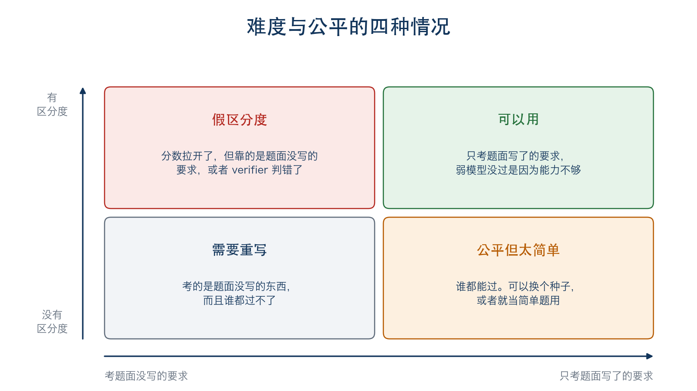
  <p><strong>Hình 8</strong> Bốn trường hợp về độ khó và sự công bằng</p>
</div>

Để nâng cao độ khó có những cách làm chính đáng, và cũng có những cách làm không nên dùng:

| Cách làm chính đáng | Cách làm không nên dùng |
| --- | --- |
| Trong phạm vi đầu vào đã công khai, tăng thêm các giá trị biên (boundary values) và các ca kiểm thử ngẫu nhiên | Kiểm tra các công thức hoặc định dạng dữ liệu ẩn mà đề bài không hề viết |
| Kiểm tra các tính chất mà đề bài có viết nhưng trước đó chưa kiểm thử tới | Kiểm tra tên lớp (class name), chuỗi ký tự trong mã nguồn, hoặc thói quen viết code của một mô hình nào đó |
| Ngữ cảnh hệ thống thực tế, đòi hỏi phải định vị vấn đề xuyên qua nhiều module | Chỉ chất đống thêm nhiều file và dữ liệu hơn, hoặc viết đề bài một cách mơ hồ |
| Nhiều nguồn thông tin xung đột lẫn nhau, nhưng đề bài ghi rõ nguồn nào có quyền quyết định | Phụ thuộc vào công cụ không thể truy cập được, hoặc lỗi mạng ngẫu nhiên |
| Ràng buộc toàn cục (global constraints), khiến cho cách giải tham lam (greedy) không đi thông được | Nhìn vào code của một mô hình nào đó để ra đề nhắm mục tiêu (targeted) |

---

## Mục 7: Kết nối vào đánh giá và huấn luyện

Nhiệm vụ đã viết xong thì phải cho chạy hàng loạt. Ở bước này có ba việc rất dễ xảy ra sai sót.

### Không phải mọi thất bại đều tính cho Agent

Sandbox không khởi động lên được, API mô hình bị giới hạn lưu lượng (rate limit) — những thứ này đều không phải là vấn đề về năng lực của Agent. Nếu ghi nhận chúng thành 0 điểm, cả việc đánh giá lẫn huấn luyện đều sẽ bị làm bẩn (polluted).

Harbor dùng `reward_valid` để phân biệt:

<div align="center">
  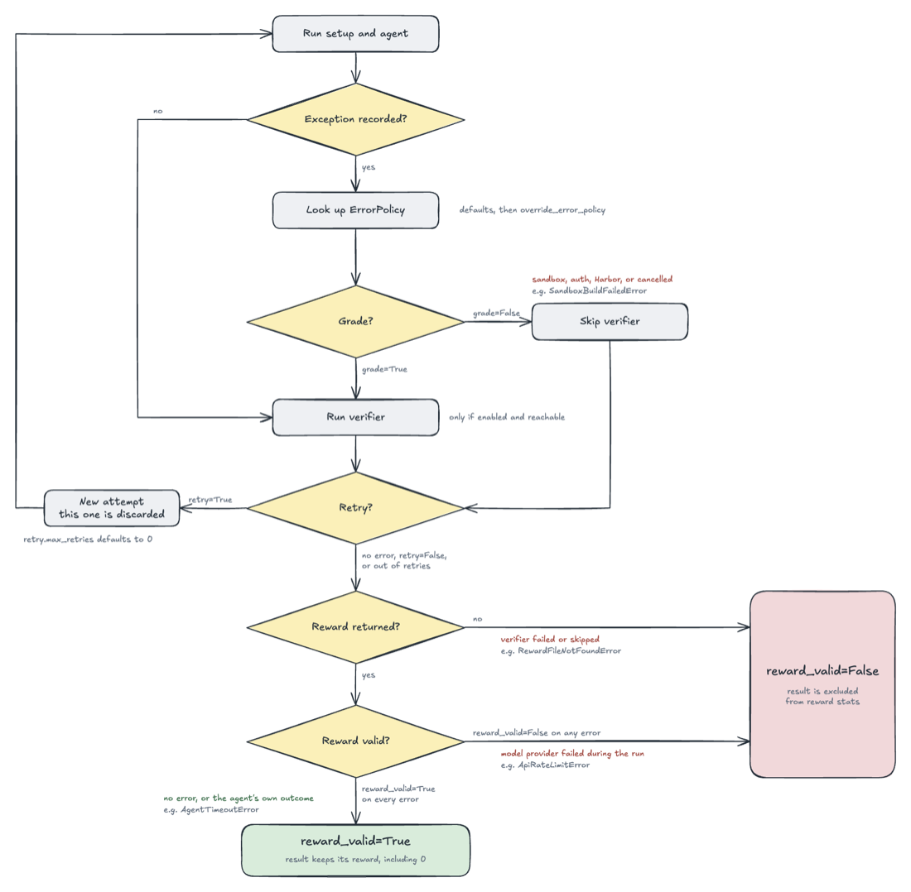
  <p><strong>Hình 9</strong> Cách Harbor phán đoán xem reward có hợp lệ hay không. Nguồn ảnh: <a href="https://github.com/harbor-framework/harbor/blob/main/docs-mintlify/jobs/error-classification.mdx">Tài liệu Harbor</a></p>
</div>

| Tình huống | Ví dụ | Có chấm điểm không | reward có hợp lệ không |
| --- | --- | --- | --- |
| Vấn đề của chính Agent | Quá thời gian (timeout), ngữ cảnh vượt quá độ dài | Có chấm | Hợp lệ, 0 điểm vẫn được tính |
| Môi trường không lên được | Xây dựng sandbox thất bại, kiểm tra sức khỏe (health check) thất bại | Không chấm | Không hợp lệ |
| Dịch vụ mô hình gặp sự cố | API bị giới hạn lưu lượng (rate limit), ngắt kết nối | Có chấm | Không hợp lệ |

### Phát lại (Regrade/Replay) hay chạy lại từ đầu (Rerun)

Môi trường trong rất nhiều trường hợp cần phải lặp lại (iterate) qua vài vòng, giống như nhiệm vụ tổng hợp chi phí ở Mục 3 trước sau đã sửa tới bốn phiên bản. Mỗi lần sửa xong, điểm số cũ còn dùng được hay không phải xem thứ được sửa là cái gì:

<div align="center">
  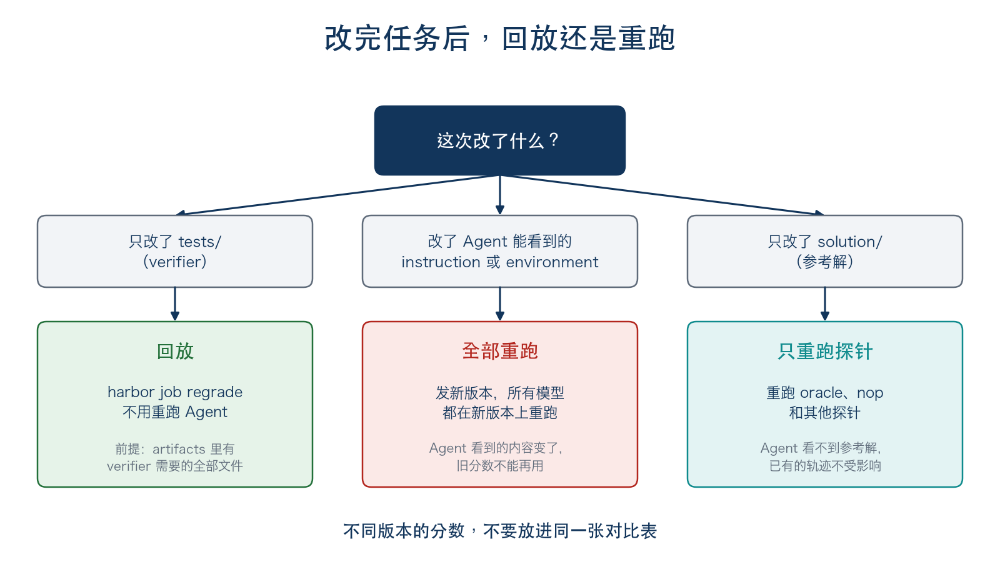
  <p><strong>Hình 10</strong> Sau khi sửa xong nhiệm vụ, nên phát lại (regrade) hay chạy lại từ đầu (rerun)</p>
</div>

Khi chỉ sửa verifier thì có thể phát lại (chấm lại). Nhiệm vụ tổng hợp chi phí từ v2 lên v3 chỉ sửa `tests/`, vừa khéo có thể lấy ra làm minh họa. Trước tiên chạy một lần lời giải gian lận sửa lại đầu vào trên bản v2, nhận được 1 điểm; sau đó dùng phần chấm điểm của v3 để phát lại (regrade) lần chạy này mà Agent không cần phải chạy lại:

```bash
cp -R expense-summary/v2 /tmp/v2-cheat
cp probes/shortcut_rewrite_input.sh /tmp/v2-cheat/solution/solve.sh
harbor run -p /tmp/v2-cheat -a oracle -o jobs           # Được 1 điểm
harbor job regrade jobs/<thư_mục_job> -p expense-summary/v3
```

```text
Regrade delta over 1 trial(s): 1 changed (0 up, 1 down), mean reward 1.000 → 0.000
```

Tiền đề của việc phát lại là chế độ separate verifier cộng với artifacts, những file mà verifier cần đều phải được thu thập lại ngay từ lúc ban đầu. Nhiệm vụ tổng hợp chi phí đã khai báo `summarize.py` thành artifact, nên phần chấm điểm của v3 mới có thể lấy được nó để chạy lại.

Còn nếu đã sửa những thứ mà Agent có thể nhìn thấy được, thì bắt buộc phải để tất cả các mô hình chạy lại từ đầu trên phiên bản mới. Chỉ chạy lại một mô hình trong số đó, hoặc đem điểm số của các phiên bản khác nhau đặt vào chung một bảng để so sánh, đều là không công bằng.

### Kết nối vào framework huấn luyện

Môi trường phụ trách việc đưa ra reward, còn việc huấn luyện thực sự thì giao cho framework RL. Lấy SkyRL làm ví dụ, tài liệu chính thức của nó có viết riêng một mục về [tích hợp Harbor](https://github.com/NovaSky-AI/SkyRL/blob/main/docs/content/docs/harbor/index.mdx): SkyRL phụ trách việc sinh đầu ra của mô hình, Harbor phụ trách việc chạy Agent trong sandbox và xác minh kết quả, reward thu được sau đó lại được đem về để cập nhật mô hình.

<div align="center">
  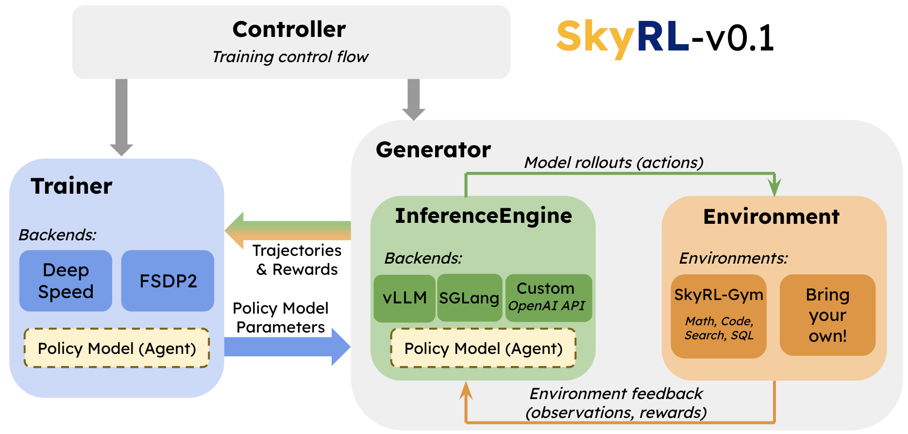
  <p><strong>Hình 11</strong> Vị trí của môi trường trong hệ thống huấn luyện: Environment ở góc dưới bên phải cung cấp quan sát (observation) và phần thưởng (reward). Nguồn ảnh: <a href="https://github.com/NovaSky-AI/SkyRL">Tài liệu SkyRL</a></p>
</div>

Bản thân việc huấn luyện ở đây sẽ không triển khai sâu thêm nữa, bạn có thể xem tiếp tại [Chương 11](../docs/chapter11/第十一章%20Agentic-RL.md) và [Extra12 Thực chiến hậu huấn luyện Trợ lý Du lịch](./Extra12-旅行助手后训练实战.md).

---

## Tài liệu tham khảo và nguồn hình ảnh

**Dự án và tài liệu**

- [Harbor](https://github.com/harbor-framework/harbor), cùng với [Harbor Cookbook](https://github.com/harbor-framework/harbor-cookbook), bên trong có các ví dụ đầy đủ hơn về đa container, đa bước, công cụ MCP, v.v.
- [Gymnasium](https://github.com/Farama-Foundation/Gymnasium)
- [OpenEnv](https://github.com/openenv/OpenEnv)
- [Prime Intellect verifiers](https://github.com/PrimeIntellect-ai/verifiers)
- [SkyRL](https://github.com/NovaSky-AI/SkyRL)

**Bài báo khoa học (Papers)**

- [Learning to Build the Environment: Self-Evolving Reasoning RL via Verifiable Environment Synthesis](https://arxiv.org/abs/2605.14392) (EvoEnv)
- [Concrete Problems in AI Safety](https://arxiv.org/abs/1606.06565)
- [Monitoring Reasoning Models for Misbehavior and the Risks of Promoting Obfuscation](https://arxiv.org/abs/2503.11926)

**Bài viết**

- [Faulty Reward Functions in the Wild](https://openai.com/index/faulty-reward-functions/) (OpenAI, 2016)
- [Reward Hacking in Reinforcement Learning](https://lilianweng.github.io/posts/2024-11-28-reward-hacking/) (Lilian Weng, 2024), hệ thống hóa một cách bài bản về reward hacking

**Nguồn hình ảnh**

Các Hình 2, 3, 4, 5, 6, 8, 10 là nguyên tác của bài viết này, Hình 7 là ảnh chụp màn hình kết quả chạy của bài viết trong trang xem của Harbor. Nguồn của các hình ảnh còn lại như sau, bản quyền thuộc về tác giả gốc:

| Hình | Nguồn | Giấy phép |
| --- | --- | --- |
| Hình 1 | [Tài liệu Gymnasium](https://github.com/Farama-Foundation/Gymnasium) | MIT |
| Hình 9 | [Tài liệu Harbor](https://github.com/harbor-framework/harbor/blob/main/docs-mintlify/jobs/error-classification.mdx) | Apache-2.0 |
| Hình 11 | [Tài liệu SkyRL](https://github.com/NovaSky-AI/SkyRL) | Apache-2.0 |
