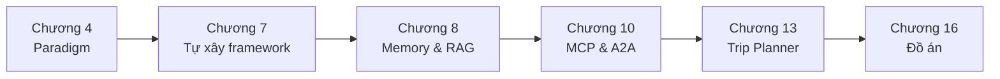

# Tutorial Hello-Agents — Lộ trình học chi tiết kèm bài tập

> Tài liệu hướng dẫn học tập repo **Hello-Agents** (Datawhale) — giáo trình xây dựng Agent từ con số 0.
> Lộ trình gồm 6 giai đoạn, mỗi chương có mục tiêu, checklist thực hành và bài tập từ cơ bản đến nâng cao.

---

## Mục lục

1. [Tổng quan repo](#1-tổng-quan-repo)
2. [Giai đoạn 0 — Chuẩn bị môi trường](#2-giai-đoạn-0--chuẩn-bị-môi-trường)
3. [Giai đoạn 1 — Nền tảng Agent và LLM (Chương 1–3)](#3-giai-đoạn-1--nền-tảng-agent-và-llm-chương-13)
4. [Giai đoạn 2 — Xây dựng LLM Agent (Chương 4–7)](#4-giai-đoạn-2--xây-dựng-llm-agent-chương-47)
5. [Giai đoạn 3 — Kiến thức nâng cao (Chương 8–12)](#5-giai-đoạn-3--kiến-thức-nâng-cao-chương-812)
6. [Giai đoạn 4 — Case study tổng hợp (Chương 13–15)](#6-giai-đoạn-4--case-study-tổng-hợp-chương-1315)
7. [Giai đoạn 5 — Đồ án tốt nghiệp (Chương 16)](#7-giai-đoạn-5--đồ-án-tốt-nghiệp-chương-16)
8. [Lộ trình rút gọn](#8-lộ-trình-rút-gọn)
9. [Tài nguyên bổ trợ](#9-tài-nguyên-bổ-trợ)

---

## 1. Tổng quan repo

| Thư mục | Nội dung |
|---|---|
| `docs/` | Lý thuyết 16 chương (tiếng Trung, có thể đọc online hoặc dùng bản dịch) |
| `code/chapter1..16/` | Code thực hành tương ứng từng chương |
| `Extra-Chapter/` | Chương phụ: phỏng vấn, FAQ, kinh nghiệm thực chiến, Skill, Web/GUI Agent |
| `Co-creation-projects/` | ~60 đồ án cộng đồng để tham khảo |
| `Additional-Chapter/` | Hướng dẫn cài N8N, Node.js |

**Triết lý của giáo trình:** không chỉ *dùng* framework có sẵn mà còn *tự xây* framework riêng (HelloAgents) để hiểu bản chất AI-native Agent.

**Yêu cầu đầu vào:**

- Python cơ bản (function, class, module, `pip`).
- Hiểu khái niệm LLM và biết gọi API (ví dụ: OpenAI-compatible API).
- Không cần kiến thức training model.

---

## 2. Giai đoạn 0 — Chuẩn bị môi trường

### 2.1. Cài đặt cơ bản

```powershell
# Tạo virtual environment tại root của repo
python -m venv .venv
.\.venv\Scripts\Activate.ps1

# Dependency dùng xuyên suốt
pip install openai python-dotenv requests

# Dùng cho chương 4 (tool search qua SerpApi)
pip install google-search-results

# Framework HelloAgents — dùng từ chương 7 trở đi (chương 7, 8, 10, 13)
pip install hello-agents
```

> Nếu `pip install hello-agents` không có bản phù hợp, cài từ source: `pip install git+https://github.com/jjyaoao/helloagents.git`.
> Chi tiết đầy đủ xem [Extra-Chapter/Extra07-环境配置.md](Extra-Chapter/Extra07-环境配置.md).

### 2.2. Chuẩn bị API key

Bạn cần ít nhất **một** LLM API key (chọn một trong các nhà cung cấp OpenAI-compatible):

- OpenAI (`https://api.openai.com/v1`)
- DeepSeek (`https://api.deepseek.com/v1`) — rẻ, phù hợp học tập
- SiliconFlow, Moonshot, Zhipu, hoặc local model qua Ollama/vLLM

Ngoài ra chuẩn bị **SerpAPI key** (miễn phí 100 lượt/tháng tại serpapi.com) cho các bài tập có tool search.

### 2.3. Cấu hình `.env`

Mỗi chương code có file mẫu (`.env copy` hoặc `.env.example`). Copy thành `.env` và điền:

```
LLM_MODEL_ID="deepseek-chat"
LLM_API_KEY="sk-..."
LLM_BASE_URL="https://api.deepseek.com/v1"
SERPAPI_API_KEY="..."
```

**Quy tắc bắt buộc:** không commit `.env` lên Git.

### ✅ Bài tập giai đoạn 0

| # | Bài tập | Mức độ |
|---|---|---|
| 0.1 | Tạo virtual environment, cài dependency, chạy script Python in ra `"Hello Agents"` | Cơ bản |
| 0.2 | Viết script 10 dòng dùng `openai` SDK + `python-dotenv` gọi LLM trả lời câu hỏi bất kỳ, in kết quả | Cơ bản |
| 0.3 | Sửa script 0.2 để stream từng token ra console (`stream=True`) | Trung bình |

---

## 3. Giai đoạn 1 — Nền tảng Agent và LLM (Chương 1–3)

> **Thời lượng gợi ý:** nhanh nếu đã có nền; tập trung chương 1 và 3.
> **Lý thuyết:** `docs/chapter1/`, `docs/chapter2/`, `docs/chapter3/`

### Chương 1 — Nhận diện Agent

**Mục tiêu:** hiểu định nghĩa Agent, phân loại (reactive, deliberative, hybrid), vòng lặp Perception → Decision → Action.

**Checklist:**

- [ ] Phân biệt được Agent "flow-driven" (Dify, n8n) và Agent "AI-native".
- [ ] Nắm các paradigm: ReAct, Plan-and-Solve, Reflection (sẽ code ở chương 4).

### Chương 2 — Lịch sử phát triển Agent

**Mục tiêu:** nắm tiến trình từ symbolic AI → expert system → RL agent → LLM-driven agent. Đọc tham khảo, không có code.

### Chương 3 — Cơ bản về LLM

**Mục tiêu:** hiểu Transformer ở mức khái niệm, prompt engineering, các giới hạn của LLM (hallucination, context window, knowledge cutoff).

**Checklist:**

- [ ] Hiểu các tham số sampling: `temperature`, `top_p`, `max_tokens`.
- [ ] Phân biệt system prompt / user prompt / assistant message.
- [ ] Hiểu tại sao LLM cần tool để vượt qua giới hạn (tính toán, search, dữ liệu real-time).

### ✅ Bài tập giai đoạn 1

| # | Bài tập | Mức độ |
|---|---|---|
| 1.1 | Viết bảng so sánh 3 loại Agent (reactive / deliberative / hybrid) với ví dụ thực tế mỗi loại | Cơ bản |
| 1.2 | Dùng script 0.2, thử cùng một prompt với `temperature` = 0 / 0.7 / 1.5, ghi nhận khác biệt | Cơ bản |
| 1.3 | Thiết kế một system prompt khiến LLM đóng vai trợ lý chỉ trả lời về Python, từ chối chủ đề khác; test với 5 câu hỏi "bẫy" | Trung bình |
| 1.4 | Hỏi LLM một phép tính lớn (ví dụ `987654 × 123456`) và một sự kiện sau knowledge cutoff; giải thích vì sao sai — đây chính là động lực cho tool calling | Trung bình |

---

## 4. Giai đoạn 2 — Xây dựng LLM Agent (Chương 4–7)

> ⭐ **Trọng tâm của toàn giáo trình.**
> **Code:** `code/chapter4/` → `code/chapter7/`

### Chương 4 — Ba paradigm kinh điển (tự tay code)

**Code:** [code/chapter4/](code/chapter4/) — gồm `llm_client.py`, `tools.py`, `ReAct.py`, `Plan_and_solve.py`, `Reflection.py`.

#### Thực hành step-by-step

**Bước 1 — Cài dependency và cấu hình key:**

```powershell
cd code\chapter4
pip install openai python-dotenv google-search-results
Copy-Item ".env copy" ".env"
```

Mở `.env` và điền đủ 4 biến: `LLM_MODEL_ID`, `LLM_API_KEY`, `LLM_BASE_URL`, `SERPAPI_API_KEY`.

**Bước 2 — Kiểm tra LLM client hoạt động độc lập:**

```powershell
python llm_client.py
```

File này có sẵn block `if __name__ == '__main__'` yêu cầu LLM viết thuật toán quicksort. Nếu thấy dòng `🧠 正在调用 ... 模型...` rồi code Python stream ra màn hình → client OK. Nếu báo `ValueError` → thiếu biến trong `.env`.

**Bước 3 — Đọc hiểu hạ tầng trước khi chạy agent:**

- [llm_client.py](code/chapter4/llm_client.py): class `HelloAgentsLLM` wrap OpenAI-compatible API, method `think(messages)` stream response.
- [tools.py](code/chapter4/tools.py): hàm `search(query)` gọi SerpApi (ưu tiên answer box → knowledge graph → 3 organic result đầu); class `ToolExecutor` quản lý tool qua `registerTool(name, description, func)`.

**Bước 4 — Chạy ReAct agent:**

```powershell
python ReAct.py
```

Câu hỏi mặc định: "Điện thoại mới nhất của Huawei là gì?". Quan sát output theo chu kỳ:

```
--- 第 1 步 ---            ← vòng lặp thứ 1 (tối đa max_steps = 5)
🧠 正在调用 ... 模型...
🤔 思考: <Thought do LLM sinh>
🎬 行动: Search[<query>]    ← agent quyết định gọi tool
🔍 正在执行 [SerpApi] 网页搜索: ...
👀 观察: <kết quả search>   ← Observation được append vào history
--- 第 2 步 ---
...
🎉 最终答案: <đáp án>       ← khi LLM xuất Action: Finish[...]
```

**Bước 5 — Đối chiếu code với trace:**

- Mở `ReAct.py`, tìm `REACT_PROMPT_TEMPLATE`: đây là prompt ép LLM trả lời đúng format `Thought:` / `Action:`.
- Xem `_parse_output()` và `_parse_action()`: parse bằng regex — thử sửa format trong prompt và quan sát agent "vỡ" thế nào (đây là điểm yếu nhất của mọi text-based agent).
- Đổi biến `question` ở cuối file thành câu hỏi của bạn (ví dụ: "Giá Bitcoin hôm nay?") rồi chạy lại.

**Bước 6 — Chạy hai paradigm còn lại:**

```powershell
python Plan_and_solve.py # Lập plan toàn bộ trước, execute từng bước sau
python Reflection.py     # Sinh draft → tự phê bình → viết lại
```

Với `Plan_and_solve.py` chú ý plan được in trước khi thực thi; với `Reflection.py` so sánh bản draft và bản final.

**Troubleshooting:**

| Lỗi | Nguyên nhân / cách xử lý |
|---|---|
| `ValueError: 模型ID、API密钥...` | `.env` thiếu biến hoặc chưa copy từ `.env copy` |
| `错误：SERPAPI_API_KEY 未在 .env 文件中配置` | Chưa điền SerpAPI key |
| `警告：未能解析出有效的Action` | LLM trả sai format — thử model mạnh hơn hoặc đặt `temperature=0` |
| Loop hết 5 bước không ra đáp án | Câu hỏi quá khó/mơ hồ, hoặc kết quả search nhiễu — thử câu hỏi cụ thể hơn |

**Walkthrough mẫu cho bài tập 4.1** (thêm tool `get_current_time`):

1. Thêm vào `tools.py`:

```python
from datetime import datetime

def get_current_time(_: str = "") -> str:
    return datetime.now().strftime("%Y-%m-%d %H:%M:%S")
```

2. Trong `ReAct.py` (block `__main__`), đăng ký thêm tool:

```python
time_desc = "Trả về ngày giờ hiện tại. Dùng khi câu hỏi liên quan đến thời gian thực."
tool_executor.registerTool("GetTime", time_desc, get_current_time)
```

3. Đổi `question = "Bây giờ là mấy giờ?"` và chạy lại — agent phải xuất `Action: GetTime[...]` thay vì `Search[...]`. Nếu agent vẫn chọn Search, viết description rõ ràng hơn (description chính là "tài liệu" duy nhất LLM đọc để chọn tool).

**Checklist:**

- [ ] Vẽ được sơ đồ vòng lặp ReAct và chỉ ra điểm dừng (final answer).
- [ ] Giải thích được khi nào Plan-and-Solve tốt hơn ReAct (task nhiều bước, ít phụ thuộc observation).
- [ ] Hiểu cơ chế parse output của LLM (regex/format) — điểm dễ vỡ nhất của Agent.

### ✅ Bài tập chương 4

| # | Bài tập | Mức độ |
|---|---|---|
| 4.1 | Thêm tool `get_current_time` vào `tools.py`, đăng ký vào ReAct agent và hỏi "Bây giờ là mấy giờ?" | Cơ bản |
| 4.2 | Thêm tool `calculator` (dùng `ast.literal_eval` hoặc thư viện an toàn — **không dùng `eval` trực tiếp**) và test lại phép tính ở bài 1.4 | Trung bình |
| 4.3 | Giới hạn ReAct tối đa 5 vòng lặp; nếu quá, trả về thông báo "không giải được" thay vì loop vô hạn | Trung bình |
| 4.4 | Cho Reflection agent viết một email xin việc, quan sát bản draft và bản sau phê bình; thêm vòng reflection thứ 2 và so sánh | Trung bình |
| 4.5 | Viết test: cho ReAct agent 10 câu hỏi (5 cần tool, 5 không), đo tỷ lệ gọi tool đúng lúc | Nâng cao |

### Chương 5 — Low-code platform (Coze, Dify, n8n)

**Mục tiêu:** trải nghiệm xây Agent không cần code để hiểu trade-off giữa low-code và code thuần.

#### Thực hành step-by-step — Chatbot FAQ trên Dify

1. Đăng ký tài khoản tại https://cloud.dify.ai (hoặc self-host bằng Docker). Hướng dẫn hình ảnh chi tiết: [Extra-Chapter/Extra03-Dify智能体创建保姆级操作流程.md](Extra-Chapter/Extra03-Dify智能体创建保姆级操作流程.md).
2. **Settings → Model Provider:** thêm API key của LLM bạn dùng (DeepSeek/OpenAI...).
3. **Knowledge:** tạo knowledge base mới → upload 1 file PDF/Markdown → chọn chế độ chunking mặc định → chờ index xong.
4. **Studio → Create App → Chatbot:** viết system prompt (ví dụ: "Chỉ trả lời dựa trên tài liệu được cung cấp, nếu không biết hãy nói không biết"), gắn knowledge base vừa tạo vào phần Context.
5. Test trong khung Preview với 5 câu hỏi: 3 câu có trong tài liệu, 2 câu không có — kiểm tra bot có "bịa" không.
6. Publish và lấy link chia sẻ.

#### Thực hành step-by-step — Workflow n8n

1. Cài Node.js theo [Additional-Chapter/NODEJS_INSTALL_GUIDE.md](Additional-Chapter/NODEJS_INSTALL_GUIDE.md), rồi cài n8n theo [Additional-Chapter/N8N_INSTALL_GUIDE.md](Additional-Chapter/N8N_INSTALL_GUIDE.md):

```powershell
npm install -g n8n
n8n start   # mở http://localhost:5678
```

2. Tạo workflow mới: node **Webhook** (trigger) → node **HTTP Request** hoặc **AI Agent** (gọi LLM tóm tắt payload) → node **Send Email**.
3. Bấm **Execute Workflow**, gửi test request bằng PowerShell:

```powershell
Invoke-RestMethod -Method Post -Uri "http://localhost:5678/webhook-test/<id>" -Body '{"text":"nội dung cần tóm tắt..."}' -ContentType "application/json"
```

4. Kiểm tra email nhận được bản tóm tắt, sau đó **Activate** workflow để chạy production.

### ✅ Bài tập chương 5

| # | Bài tập | Mức độ |
|---|---|---|
| 5.1 | Tạo một chatbot FAQ trên Dify (hoặc Coze) với knowledge base là 1 file PDF bất kỳ | Cơ bản |
| 5.2 | Dựng workflow n8n: nhận webhook → gọi LLM tóm tắt nội dung → gửi kết quả qua email | Trung bình |
| 5.3 | Viết so sánh ngắn (nửa trang): cùng một chatbot FAQ, làm bằng Dify vs code thuần chương 4 — ưu nhược điểm từng cách | Trung bình |

### Chương 6 — Framework chủ lưu (AutoGen, AgentScope, CAMEL, LangGraph)

**Code:** [code/chapter6/](code/chapter6/) — gồm 4 thư mục demo: `AutoGenDemo/`, `AgentScopeDemo/`, `CAMEL/`, `Langgraph/`.

#### Thực hành step-by-step

> Khuyến nghị tạo virtual environment **riêng cho mỗi framework** để tránh conflict dependency.

**LangGraph (ưu tiên số 1):**

1. Cài đặt và vào thư mục demo:

```powershell
cd code\chapter6\Langgraph
pip install langgraph langchain-openai python-dotenv
```

2. Mở file demo, xem cấu trúc 3 thành phần: **State** (TypedDict lưu dữ liệu chảy qua graph), **Node** (hàm nhận state → trả state mới), **Edge** (nối node, có conditional edge rẽ nhánh).
3. Cấu hình key (qua `.env` hoặc biến môi trường) rồi chạy file demo chính.
4. Bài kiểm tra hiểu bài: vẽ lại graph của demo ra giấy (node nào, edge nào, điều kiện rẽ nhánh ở đâu) trước khi làm bài tập 6.1.

**AutoGen (ưu tiên số 2):**

1. Cài đặt:

```powershell
cd code\chapter6\AutoGenDemo
pip install pyautogen python-dotenv
```

2. Chạy demo, quan sát 2 pattern chính: `AssistantAgent` (LLM trả lời) và `UserProxyAgent` (đại diện user, có thể execute code).
3. Chú ý tham số `max_consecutive_auto_reply` và điều kiện dừng hội thoại (`is_termination_msg`) — thiếu chúng 2 agent sẽ "nói chuyện" mãi và đốt token.

**AgentScope / CAMEL (tùy chọn):** làm tương tự — cài package theo import trong file demo, chạy và so sánh với 2 framework trên theo 3 tiêu chí: lượng boilerplate code, khả năng debug, độ linh hoạt.

**Checklist:**

- [ ] Hiểu khái niệm graph/node/edge trong LangGraph.
- [ ] Hiểu conversation pattern giữa các agent trong AutoGen.

### ✅ Bài tập chương 6

| # | Bài tập | Mức độ |
|---|---|---|
| 6.1 | Dựng LangGraph gồm 3 node: `classify` (phân loại câu hỏi) → `research` hoặc `direct_answer` (conditional edge) → `respond` | Trung bình |
| 6.2 | Dùng AutoGen tạo 2 agent "Coder" và "Reviewer" đối thoại để viết + review một function Python | Trung bình |
| 6.3 | Làm lại bài 6.1 bằng framework thứ hai (AgentScope hoặc CAMEL), so sánh lượng code và độ dễ debug | Nâng cao |

### Chương 7 — Tự xây framework HelloAgents ⭐

**Code:** [code/chapter7/](code/chapter7/) — `my_llm.py`, `my_simple_agent.py`, `my_react_agent.py`, `my_calculator_tool.py`, `my_advanced_search.py`, `my_main.py` + bộ test `test_*.py`.

> Chương này code mẫu **extend framework `hello_agents`** (import `SimpleAgent`, `HelloAgentsLLM`, `ToolRegistry`... từ package) để dạy cách tự xây từng tầng. Đọc song song với lý thuyết `docs/chapter7/` nơi từng class được xây từ số 0.

#### Thực hành step-by-step

**Bước 1 — Cài framework và cấu hình:**

```powershell
cd code\chapter7
pip install hello-agents
Copy-Item ".env.example" ".env"   # rồi điền LLM key
```

**Bước 2 — Tầng LLM wrapper:** đọc [my_llm.py](code/chapter7/my_llm.py) — class `MyLLM` kế thừa LLM base của framework, override provider. Chạy entry point:

```powershell
python my_main.py
```

File này khởi tạo `MyLLM(provider="modelscope")` và stream câu trả lời tự giới thiệu. **Lưu ý:** nếu không dùng ModelScope, sửa `provider` trong `my_main.py` cho khớp với LLM của bạn.

**Bước 3 — Tầng Agent đơn giản:** đọc [my_simple_agent.py](code/chapter7/my_simple_agent.py) — class `MySimpleAgent(SimpleAgent)` với method `run()` tự viết lại. Chú ý 3 khối trong `run()`: build messages (system + history + user) → nhánh không tool (gọi `llm.invoke` trực tiếp) → nhánh có tool (`_run_with_tools`, tối đa `max_tool_iterations=3` vòng). Kiểm chứng:

```powershell
python test_simple_agent.py
```

**Bước 4 — Tầng Tool:** đọc [my_calculator_tool.py](code/chapter7/my_calculator_tool.py) — điểm quan trọng nhất: hàm `my_calculate` parse biểu thức bằng `ast.parse` + whitelist operator (`+ - * /`, `sqrt`, `pi`) thay vì `eval()` → đây là pattern an toàn bắt buộc. Kiểm chứng:

```powershell
python test_my_calculator.py
```

**Bước 5 — Tầng ReAct + tool nâng cao:** đọc `my_react_agent.py` và `my_advanced_search.py`, rồi chạy:

```powershell
python test_react_agent.py
python test_advanced_search.py
python test_plan_solve_agent.py
python test_reflection_agent.py
```

So sánh ReAct ở đây với bản "thô" của chương 4: framework đã chuẩn hóa những gì (tool registry, message history, parse output)?

**Bước 6 — Đối chiếu framework gốc:** mở https://github.com/jjyaoao/helloagents, tìm class `SimpleAgent` và `ToolRegistry` gốc để thấy phần nào code mẫu đã override.

**Walkthrough mẫu cho bài tập 7.1** (tool thời tiết):

1. Tạo `my_weather_tool.py` theo đúng pattern của `my_calculator_tool.py`:

```python
import requests

def my_get_weather(city_coords: str) -> str:
    """Input dạng "lat,lon", ví dụ "21.03,105.85" (Hà Nội)."""
    try:
        lat, lon = city_coords.split(",")
        url = ("https://api.open-meteo.com/v1/forecast"
               f"?latitude={lat.strip()}&longitude={lon.strip()}&current_weather=true")
        data = requests.get(url, timeout=10).json()
        w = data["current_weather"]
        return f"Nhiệt độ: {w['temperature']}°C, gió: {w['windspeed']} km/h"
    except Exception as e:
        return f"Lỗi lấy thời tiết: {e}"
```

2. Đăng ký vào `ToolRegistry` giống cách `my_calculator_tool.py` làm (cùng interface name/description/function).
3. Viết `test_my_weather.py` bắt chước `test_my_calculator.py`: 1 case tọa độ hợp lệ, 1 case input rác.
4. Chạy test và hỏi agent: "Thời tiết Hà Nội thế nào?" — agent phải tự chọn weather tool.

**Checklist:**

- [ ] Hiểu 4 tầng của framework: LLM wrapper → Tool system → Agent paradigm → Entry point.
- [ ] Hiểu cách tool được register và cách agent chọn tool.

### ✅ Bài tập chương 7

| # | Bài tập | Mức độ |
|---|---|---|
| 7.1 | Viết tool mới `my_weather_tool.py` (dùng API miễn phí như open-meteo.com) theo đúng interface của `my_calculator_tool.py`, kèm file test | Trung bình |
| 7.2 | Thêm paradigm `PlanSolveAgent` vào framework của bạn (tham khảo `test_plan_solve_agent.py`) | Nâng cao |
| 7.3 | Thêm tính năng ghi log mỗi vòng ReAct (thought/action/observation) ra file JSON để debug | Trung bình |
| 7.4 | **Mini-project:** đóng gói framework thành package cài được bằng `pip install -e .` với `pyproject.toml` | Nâng cao |

---

## 5. Giai đoạn 3 — Kiến thức nâng cao (Chương 8–12)

> Dùng framework HelloAgents từ chương 7 làm nền. Chương 11 (Agentic RL) cần GPU — có thể học lý thuyết trước, thực hành sau.

### Chương 8 — Memory và RAG

**Code:** [code/chapter8/](code/chapter8/) — 11 file đánh số `01_` → `11_`, chạy theo thứ tự.

#### Thực hành step-by-step

**Bước 1 — Chuẩn bị:**

```powershell
cd code\chapter8
pip install hello-agents markitdown
Copy-Item ".env.example" ".env"   # điền LLM key (embedding dùng chung endpoint)
```

**Bước 2 — Memory cơ bản (file 01–03):**

```powershell
python 01_MemoryTool_Basic_Operations.py
```

Quan sát: `MemoryTool` khởi tạo với 4 loại memory (`working`, `episodic`, `semantic`, `perceptual`); mỗi lần `add` đều kèm `importance` (0→1) và metadata (`event_type`, `location`...). Thử sửa `importance` một bản ghi xuống `0.1` và xem nó có bị loại khi search không.

```powershell
python 02_MemoryTool_Architecture.py   # kiến trúc bên trong MemoryTool
python 03_WorkingMemory_Implementation.py   # working memory: dung lượng nhỏ, phai nhanh
```

**Bước 3 — RAG pipeline (file 04–05):**

```powershell
python 04_RAGTool_MarkItDown_Pipeline.py   # ingest tài liệu: MarkItDown → chunk → embed → store
python 05_RAGTool_Advanced_Search.py       # retrieve + rerank
```

Sau khi chạy `04`, note lại: tài liệu bị cắt thành bao nhiêu chunk? Mỗi chunk bao nhiêu ký tự? (dùng cho bài tập 8.2).

**Bước 4 — Consolidation và tích hợp (file 06–08):**

```powershell
python 06_Memory_Consolidation_Demo.py   # working memory → long-term (mô phỏng "giấc ngủ")
python 07_RAGTool_Intelligent_QA.py
python 08_Agent_Tool_Integration.py      # gắn MemoryTool + RAGTool vào Agent
```

**Bước 5 — Tổng hợp (file 09–11):**

```powershell
python 09_Memory_Types_Deep_Dive.py
python "10_RAG_Pipeline_Complete.py"
python "11_Q&A_Assistant.py"   # assistant hoàn chỉnh: hỏi đáp trên tài liệu + nhớ hội thoại
```

Với file `11`, test kịch bản 2 lượt: lượt 1 nói "Tôi tên Phi, đang học RAG", lượt 2 hỏi "Tôi tên gì?" — kiểm chứng memory hoạt động xuyên lượt.

**Checklist:**

- [ ] Phân biệt working memory / episodic / semantic / procedural memory.
- [ ] Hiểu pipeline RAG: ingest → chunk → embed → store → retrieve → rerank → generate.

### ✅ Bài tập chương 8

| # | Bài tập | Mức độ |
|---|---|---|
| 8.1 | Nạp một file PDF/Markdown của riêng bạn vào RAG pipeline (`04`), hỏi 5 câu và đánh giá độ chính xác | Cơ bản |
| 8.2 | Thử 3 kích thước chunk khác nhau (256/512/1024 token), so sánh chất lượng retrieve với cùng bộ câu hỏi | Trung bình |
| 8.3 | Thêm memory vào ReAct agent chương 7: agent nhớ tên người dùng và sở thích qua nhiều lượt hội thoại | Nâng cao |
| 8.4 | Xây Q&A assistant cho chính repo này: ingest toàn bộ `docs/`, trả lời câu hỏi về nội dung giáo trình | Nâng cao |

### Chương 9 — Context Engineering

**Lý thuyết:** `docs/chapter9/` + [Extra-Chapter/Extra02-上下文工程补充知识.md](Extra-Chapter/Extra02-上下文工程补充知识.md).

**Checklist:**

- [ ] Nắm các kỹ thuật: context compression, summarization, sliding window, structured context.
- [ ] Hiểu trade-off giữa đưa nhiều context và chi phí/nhiễu.

### ✅ Bài tập chương 9

| # | Bài tập | Mức độ |
|---|---|---|
| 9.1 | Viết hàm `compress_history`: khi hội thoại vượt N token, tóm tắt các lượt cũ thành 1 message | Trung bình |
| 9.2 | Thử nghiệm "lost in the middle": đặt 1 thông tin quan trọng ở đầu/giữa/cuối context dài, đo tỷ lệ LLM trả lời đúng | Trung bình |
| 9.3 | Tích hợp `compress_history` vào agent chương 7 + memory chương 8 thành một chatbot chạy được hội thoại 50+ lượt | Nâng cao |

### Chương 10 — Giao thức Agent (MCP, A2A, ANP)

**Code:** [code/chapter10/](code/chapter10/) — file đánh số `01_` → `14_`, chia 3 cụm:

- `01–06`: **MCP** (Model Context Protocol) — kết nối tool chuẩn hóa.
- `07–10`: **A2A** (Agent-to-Agent) — agent giao tiếp với nhau.
- `11–13`: **ANP** — phân phối task và load balancing.
- `14`: tổng hợp — weather agent dùng MCP server tự viết.

#### Thực hành step-by-step

**Bước 1 — Chuẩn bị:**

```powershell
cd code\chapter10
pip install hello-agents mcp
Copy-Item ".env.example" ".env"
```

**Bước 2 — Cụm MCP (file 01–06):**

```powershell
python 01_TestConnect.py
```

File này demo cả 3 protocol trong ~25 dòng: `MCPTool` gọi tool `add(10, 20)` → kỳ vọng in `30.0`; `ANPTool` register + discover service; `A2ATool` khởi tạo client. Nếu chạy OK nghĩa là môi trường đủ.

```powershell
python 02_Connect2MCP.py        # kết nối MCP server thật
python 03_GitHubMCP.py          # dùng GitHub MCP server (cần GitHub token)
python 04_MCPTransport.py       # so sánh transport: stdio vs SSE/HTTP
python 05_UseMCPToolInAgent.py  # agent tự chọn và gọi MCP tool
```

Sau đó mở [my_mcp_server.py](code/chapter10/my_mcp_server.py): một MCP server tối giản — chú ý cách khai báo tool bằng decorator và chạy qua stdio. Đây là template cho bài tập 10.1.

**Bước 3 — Cụm A2A (file 07–10), cần 2 terminal:**

```powershell
# Terminal 1 — khởi động server, giữ chạy
python 09_A2A_Server.py
```

```powershell
# Terminal 2 — client gọi sang
python 09_A2A_Client.py
```

Quan sát: client discover agent card của server (tên, skill, endpoint) rồi gửi task. Tiếp theo chạy `09_A2A_Network.py` (nhiều agent nối mạng) và `10_AgentNegotiation.py` (2 agent thương lượng) để thấy pattern giao tiếp phức tạp hơn.

**Bước 4 — Cụm ANP (file 11–13):**

```powershell
python 11_ANPInit.py              # đăng ký service
python 12_ANPTaskDistribution.py  # phân phối task cho agent phù hợp
python 13_ANPLoadBalancing.py     # cân bằng tải giữa nhiều agent cùng loại
```

**Bước 5 — Pipeline tổng hợp (bộ 14, cần 2 terminal):**

```powershell
# Terminal 1
python 14_weather_mcp_server.py

# Terminal 2
python 14_test_weather_server.py   # test server trước
python 14_weather_agent.py         # agent hỏi thời tiết qua MCP
```

Đây chính là flow chuẩn production: **MCP server (cung cấp tool) → Agent (reasoning) → test (kiểm chứng)** — áp dụng y nguyên cho bài tập 10.2.

### ✅ Bài tập chương 10

| # | Bài tập | Mức độ |
|---|---|---|
| 10.1 | Viết MCP server có 2 tool: `get_time` và `random_quote`; kết nối từ agent và gọi thử | Trung bình |
| 10.2 | Sửa `14_weather_mcp_server.py` để thêm forecast 3 ngày (API open-meteo) | Trung bình |
| 10.3 | Dựng 2 agent A2A: agent "Translator" và agent "Summarizer"; client gửi văn bản tiếng Anh → nhận bản tóm tắt tiếng Việt | Nâng cao |
| 10.4 | Cấu hình MCP server của bạn vào VS Code / Claude Desktop và gọi tool từ chat thật | Nâng cao |

### Chương 11 — Agentic RL (SFT → GRPO)

**Lý thuyết:** `docs/chapter11/`; code trong `code/chapter11/`. Cần GPU (hoặc thuê cloud GPU/Colab).

**Checklist:**

- [ ] Hiểu pipeline: base model → SFT → reward design → GRPO.
- [ ] Phân biệt RLHF truyền thống và Agentic RL (reward từ kết quả thực thi tool/task).

### ✅ Bài tập chương 11

| # | Bài tập | Mức độ |
|---|---|---|
| 11.1 | Không cần GPU: viết reward function chấm điểm output của agent chương 4 (đúng format +1, gọi tool hợp lệ +1, kết quả đúng +3) | Trung bình |
| 11.2 | Chạy SFT một model nhỏ (ví dụ Qwen2.5-0.5B) trên Colab theo hướng dẫn chương 11 | Nâng cao |
| 11.3 | Đọc [Extra-Chapter/Extra12-旅行助手后训练实战.md](Extra-Chapter/Extra12-旅行助手后训练实战.md) và tóm tắt quy trình post-training thành checklist | Trung bình |

### Chương 12 — Đánh giá hiệu năng Agent

**Lý thuyết:** `docs/chapter12/`; code trong `code/chapter12/`.

**Checklist:**

- [ ] Nắm các metric: task success rate, tool-call accuracy, latency, cost per task.
- [ ] Biết các benchmark: GAIA, AgentBench, SWE-bench (mức khái niệm).

### ✅ Bài tập chương 12

| # | Bài tập | Mức độ |
|---|---|---|
| 12.1 | Xây bộ eval 20 câu hỏi (có đáp án chuẩn) cho ReAct agent chương 7; viết script tự động chấm success rate | Trung bình |
| 12.2 | Dùng kỹ thuật LLM-as-a-judge: cho một LLM khác chấm điểm câu trả lời của agent theo rubric 1–5 | Nâng cao |
| 12.3 | So sánh agent chương 7 với 2 model khác nhau trên cùng bộ eval 12.1, lập bảng kết quả (accuracy, tổng token, chi phí) | Nâng cao |

---

## 6. Giai đoạn 4 — Case study tổng hợp (Chương 13–15)

### Chương 13 — Trợ lý du lịch thông minh (Trip Planner)

**Code:** [code/chapter13/helloagents-trip-planner/](code/chapter13/helloagents-trip-planner/) — ứng dụng full-stack: backend FastAPI + HelloAgents + Amap MCP, frontend Vue 3 + TypeScript.

#### Thực hành step-by-step

**Yêu cầu trước:** Python 3.10+, Node.js 16+, LLM API key, và **Amap (高德) API key** gồm 2 loại: Web Service API (backend) và Web JS API (frontend) — đăng ký miễn phí tại https://console.amap.com.

**Bước 1 — Backend:**

```powershell
cd code\chapter13\helloagents-trip-planner\backend
python -m venv venv
.\venv\Scripts\Activate.ps1
pip install -r requirements.txt
Copy-Item ".env.example" ".env"   # điền LLM key + Amap Web Service key
uvicorn app.api.main:app --reload --host 0.0.0.0 --port 8000
```

Kiểm tra backend sống: mở http://localhost:8000/docs (Swagger UI của FastAPI).

**Bước 2 — Frontend (terminal mới):**

```powershell
cd code\chapter13\helloagents-trip-planner\frontend
npm install
Copy-Item ".env.example" ".env"   # điền Amap JS API key
npm run dev                        # mở http://localhost:5173
```

**Bước 3 — Chạy end-to-end:** nhập yêu cầu lập kế hoạch (thành phố, số ngày, sở thích) trên UI → nhận lịch trình gồm điểm tham quan, route, thời tiết, gợi ý ăn ở.

**Bước 4 — Trace kiến trúc (quan trọng nhất):** lần theo code một request:

1. `frontend/src/services/` gửi request → `backend/app/api/routes/trip.py`.
2. Route gọi `app/agents/trip_planner_agent.py` — một `SimpleAgent` của HelloAgents.
3. Agent gọi tool qua **amap-mcp-server** (`app/services/amap_service.py`): tìm POI, tính route, xem thời tiết.
4. Agent tổng hợp kết quả tool thành lịch trình → trả JSON theo `app/models/schemas.py` → frontend render lên bản đồ.

Vẽ lại sequence diagram của flow này trước khi làm bài tập 13.2 (thêm agent "Budget Advisor" = thêm 1 bước trong chain + 1 route hoặc merge vào prompt của planner).

### ✅ Bài tập chương 13

| # | Bài tập | Mức độ |
|---|---|---|
| 13.1 | Chạy trip planner với một thành phố Việt Nam (Đà Nẵng, Hà Nội...) và đánh giá chất lượng lịch trình | Cơ bản |
| 13.2 | Thêm một agent "Budget Advisor" ước tính chi phí cho lịch trình | Nâng cao |
| 13.3 | Thay tool search mặc định bằng MCP server tự viết ở bài 10.1/10.2 | Nâng cao |

### Chương 14 — DeepResearch Agent

**Lý thuyết + code:** `docs/chapter14/`, `code/chapter14/`.

**Checklist:**

- [ ] Hiểu pipeline deep research: decompose câu hỏi → search đa vòng → đọc & tổng hợp → viết report có trích dẫn.

### ✅ Bài tập chương 14

| # | Bài tập | Mức độ |
|---|---|---|
| 14.1 | Chạy DeepResearch agent với một chủ đề kỹ thuật, kiểm chứng 3 trích dẫn bất kỳ trong report | Cơ bản |
| 14.2 | Thêm bước "critic": một agent phản biện report trước khi xuất bản, buộc viết lại nếu thiếu dẫn chứng | Nâng cao |

### Chương 15 — Cyber Town (xã hội Agent mô phỏng)

**Lý thuyết + code:** `docs/chapter15/`, `code/chapter15/`.

**Checklist:**

- [ ] Hiểu kiến trúc generative agents: memory stream, reflection, planning, social interaction.

### ✅ Bài tập chương 15

| # | Bài tập | Mức độ |
|---|---|---|
| 15.1 | Chạy mô phỏng mặc định, quan sát log tương tác giữa các cư dân | Cơ bản |
| 15.2 | Thêm một cư dân mới với nghề nghiệp và tính cách tự thiết kế; quan sát ảnh hưởng tới xã hội | Trung bình |
| 15.3 | Thêm một "sự kiện" (ví dụ lễ hội) và phân tích các agent phản ứng thế nào qua memory stream | Nâng cao |

---

## 7. Giai đoạn 5 — Đồ án tốt nghiệp (Chương 16)

### Quy trình làm đồ án

1. **Chọn đề tài:** duyệt [Co-creation-projects/](Co-creation-projects/) để tham khảo ~60 đồ án cộng đồng (DataAnalysisAgent, CodeReviewAgent, PaperAssistant, StockInsightAgent...). Chọn bài toán bạn thật sự gặp trong công việc/cuộc sống.
2. **Khởi tạo từ template:** copy cấu trúc từ [Co-creation-projects/EXAMPLE-ProjectTemplate/](Co-creation-projects/EXAMPLE-ProjectTemplate/).
3. **Thiết kế trước khi code:** xác định (a) agent nào, (b) tool nào, (c) memory gì, (d) giao thức gì (MCP/A2A), (e) metric đánh giá.
4. **Yêu cầu tối thiểu của đồ án:**
   - Dùng framework HelloAgents (hoặc framework tự xây ở chương 7).
   - Ít nhất 2 agent phối hợp hoặc 1 agent + 3 tool trở lên.
   - Có memory hoặc RAG.
   - Có README mô tả kiến trúc + hướng dẫn chạy + demo.
   - Có bộ eval tối thiểu 10 test case (áp dụng chương 12).
5. **Nộp (tùy chọn):** mở Pull Request vào `Co-creation-projects/` theo format thư mục `<github-username>-<tên-project>/`.

### Gợi ý đề tài theo độ khó

| Độ khó | Đề tài gợi ý |
|---|---|
| ⭐ | Email digest agent, Daily news summarizer, FAQ bot cho tài liệu nội bộ |
| ⭐⭐ | Code review agent, Paper reading assistant (RAG + citation), Meeting action-item extractor |
| ⭐⭐⭐ | Multi-agent data analyst (planner + coder + reporter), Job match agent, Personal finance advisor với memory dài hạn |

---

## 8. Lộ trình rút gọn

Nếu thời gian hạn chế và đã có nền LLM:



Bỏ qua: chương 2 (lịch sử), chương 5 (low-code) nếu đã quen Dify/n8n, chương 11 nếu chưa có GPU, chương 15 nếu không quan tâm simulation.

---

## 9. Tài nguyên bổ trợ

| Tài nguyên | Đường dẫn |
|---|---|
| Đọc online | https://datawhalechina.github.io/hello-agents/ |
| PDF chính thức | https://github.com/datawhalechina/hello-agents/releases/latest/ |
| Framework HelloAgents | https://github.com/jjyaoao/helloagents |
| Câu hỏi phỏng vấn Agent | [Extra-Chapter/Extra01-面试问题总结.md](Extra-Chapter/Extra01-面试问题总结.md) + [đáp án](Extra-Chapter/Extra01-参考答案.md) |
| FAQ khóa học | [Extra-Chapter/Extra04-DatawhaleFAQ.md](Extra-Chapter/Extra04-DatawhaleFAQ.md) |
| Agent Skills vs MCP | [Extra-Chapter/Extra05-AgentSkills解读.md](Extra-Chapter/Extra05-AgentSkills解读.md) |
| GUI Agent thực chiến | [Extra-Chapter/Extra06-GUIAgent科普与实战.md](Extra-Chapter/Extra06-GUIAgent科普与实战.md) |
| Cách viết Skill tốt | [Extra-Chapter/Extra08-如何写出好的Skill.md](Extra-Chapter/Extra08-如何写出好的Skill.md) |
| Kinh nghiệm tránh pitfall | [Extra-Chapter/Extra09-Agent应用开发实践踩坑与经验分享.md](Extra-Chapter/Extra09-Agent应用开发实践踩坑与经验分享.md) |
| Agent Self-Evolution | [Extra-Chapter/Extra10-Agent自进化.md](Extra-Chapter/Extra10-Agent自进化.md) |
| Web Agent thực chiến | [Extra-Chapter/Extra11-WebAgent科普与实战.md](Extra-Chapter/Extra11-WebAgent科普与实战.md) |

### Mẹo học hiệu quả

- **Code trước, đọc sau:** chạy demo cho lỗi rồi quay lại đọc lý thuyết sẽ nhớ lâu hơn.
- **Ghi log mọi trace:** thói quen in/lưu thought-action-observation giúp debug Agent nhanh gấp nhiều lần.
- **Mỗi chương một commit:** quản lý bài tập bằng Git branch riêng để dễ nhìn lại tiến độ.
- **Kiểm soát chi phí:** dùng model rẻ (deepseek-chat, gpt-4o-mini) khi dev, chỉ dùng model mạnh khi eval cuối.
- **An toàn:** không bao giờ dùng `eval()` trực tiếp cho tool calculator; không commit API key.
